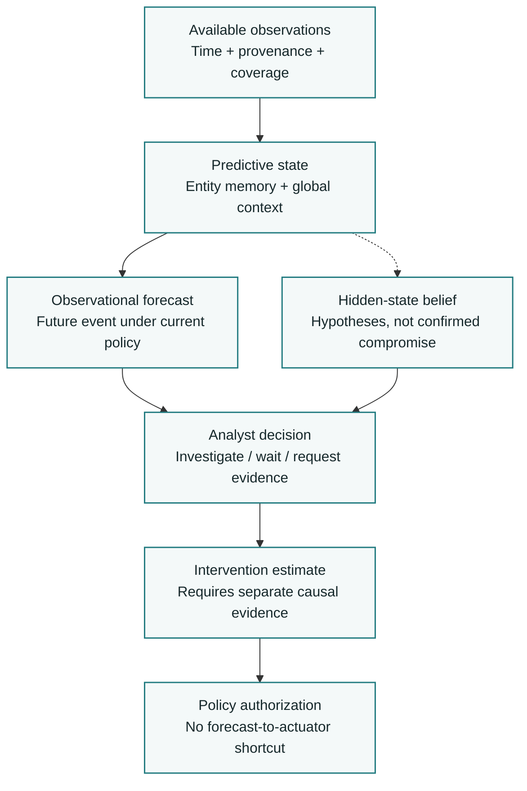
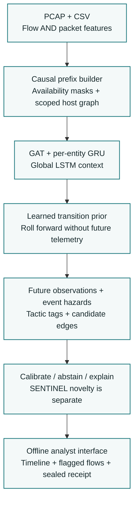
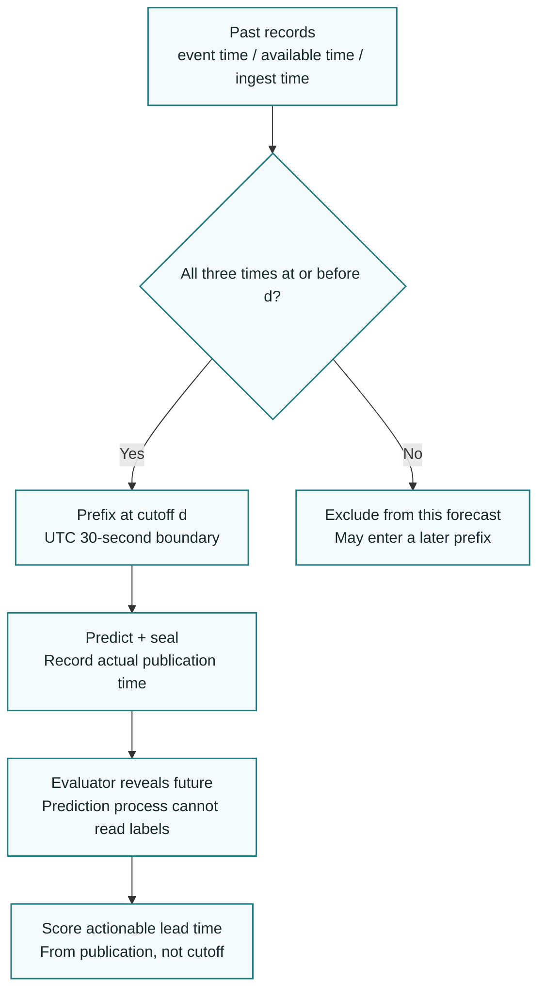
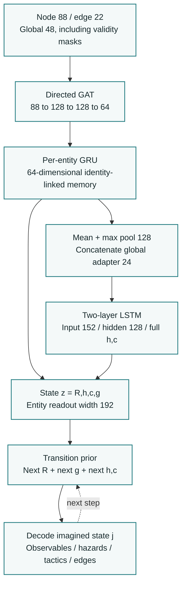
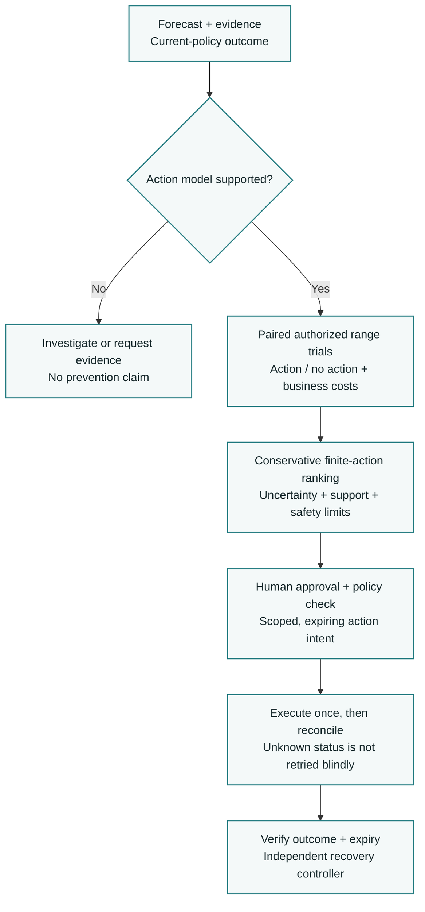
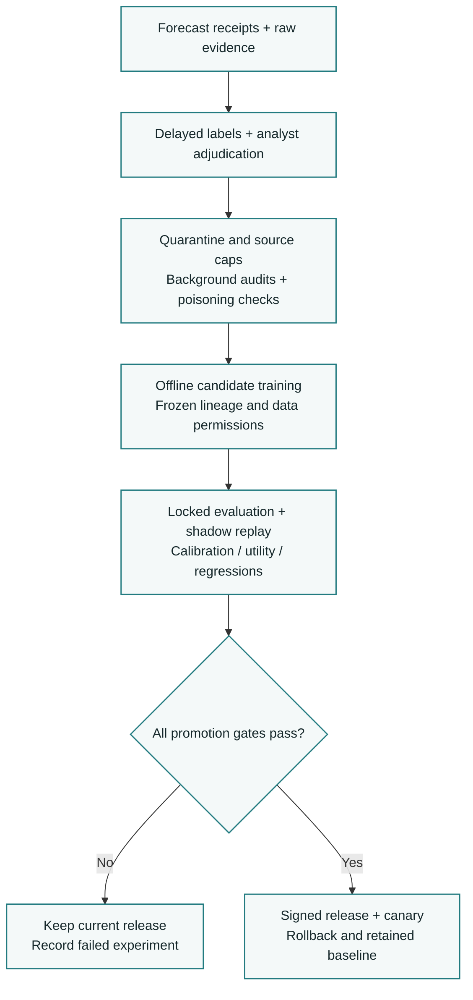
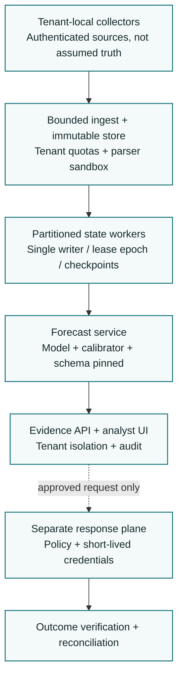

# FORESIGHT Build Specification

This is a self-contained technical implementation specification for the 62-page `FORESIGHT_Final_Architecture.pdf`. The PDF is the visual architecture reference; this Markdown contains its technical architecture, all seven diagrams as editable Mermaid, the research/validation material and a substantially expanded implementation handbook for humans and coding agents.

**Reference PDF SHA-256:** `455d80112e66ae8483f0c0b53f9f51619f89a9363d3b12f5ebde46f1153edeb1`.

**Authority:** Sections 1-35 and Appendices A-B reproduce the reference architecture's technical content, with nontechnical business framing and personnel allocation omitted. Appendices C-T elaborate implementation details without changing the core model or promoting optional research into mandatory scope. Where the PDF leaves a choice open, an explicit implementation default and its required tests are stated. No trained weights, measured performance or completed software are claimed by this specification.

**Use:** Give this entire file to a coding agent together with the PDF. Keep the data/time, feature, probability, artifact and authorization contracts intact. The document has no external image dependencies; Mermaid diagrams can render directly on GitHub. The reference PDF is unchanged. The later unfinished signature-architecture proposal is not included.

## Navigation

- [1. Authority and Build Decision](#1-authority-and-build-decision)
- [2. SIH26153 Compliance](#2-sih26153-compliance)
- [3. Mission and Information Boundaries](#3-mission-and-information-boundaries)
- [4. Delivery Tiers](#4-delivery-tiers)
- [5. Component Hierarchy](#5-component-hierarchy)
- [6. Data Qualification Before Model Training](#6-data-qualification-before-model-training)
- [7. Time, Availability and Sealing](#7-time-availability-and-sealing)
- [8. Canonical Events, Identity and Scope](#8-canonical-events-identity-and-scope)
- [9. Flow and Packet Semantics](#9-flow-and-packet-semantics)
- [10. Feature Registry and Shapes](#10-feature-registry-and-shapes)
- [11. Targets, Labels and Risk Sets](#11-targets-labels-and-risk-sets)
- [12. Probability and ETA Contract](#12-probability-and-eta-contract)
- [13. Selected Reference World Model](#13-selected-reference-world-model)
- [14. Learned Transitions and Observable Rollout](#14-learned-transitions-and-observable-rollout)
- [15. Training Objectives and Schedule](#15-training-objectives-and-schedule)
- [16. Calibration and Trust Contract](#16-calibration-and-trust-contract)
- [17. SENTINEL and Unknown Attacks](#17-sentinel-and-unknown-attacks)
- [18. Operational States and Degradation](#18-operational-states-and-degradation)
- [19. Explainability and Analyst Workflow](#19-explainability-and-analyst-workflow)
- [20. Attack-Path Engine](#20-attack-path-engine)
- [21. Active Perception](#21-active-perception)
- [22. Intervention Models and Causal Evidence](#22-intervention-models-and-causal-evidence)
- [23. Safe Response Execution](#23-safe-response-execution)
- [24. Continual Learning and Evidence Quality](#24-continual-learning-and-evidence-quality)
- [25. Runtime, APIs and Reproducibility](#25-runtime-apis-and-reproducibility)
- [26. Inference Algorithm](#26-inference-algorithm)
- [27. Production Deployment and Scale](#27-production-deployment-and-scale)
- [28. Threat Model and Security Controls](#28-threat-model-and-security-controls)
- [29. Falsification and Benchmark Program](#29-falsification-and-benchmark-program)
- [30. Build Sequence and 120-Second Demo](#30-build-sequence-and-120-second-demo)
- [31. Research Landscape and Architecture Tournament](#31-research-landscape-and-architecture-tournament)
- [32. Research Candidate Register](#32-research-candidate-register)
- [33. Adversarial Review and Resolutions](#33-adversarial-review-and-resolutions)
- [34. Advanced Engineering and Release Boundaries](#34-advanced-engineering-and-release-boundaries)
- [35. Exact Build Configuration and Golden Contracts](#35-exact-build-configuration-and-golden-contracts)
- [Appendix A. Architecture Autopsy and Decision Record](#appendix-a-architecture-autopsy-and-decision-record)
- [Appendix B. Sources and Evidence Boundaries](#appendix-b-sources-and-evidence-boundaries)
- [Appendix C. Implementation Authority and Repository Contract](#appendix-c-implementation-authority-and-repository-contract)
- [Appendix D. Complete Data Contracts](#appendix-d-complete-data-contracts)
- [Appendix E. Storage, Serialization and Sealing](#appendix-e-storage-serialization-and-sealing)
- [Appendix F. Ingestion and Prefix-Safe Feature Engineering](#appendix-f-ingestion-and-prefix-safe-feature-engineering)
- [Appendix G. Identity, Graphs and Clip Construction](#appendix-g-identity-graphs-and-clip-construction)
- [Appendix H. Reference World Model Implementation](#appendix-h-reference-world-model-implementation)
- [Appendix I. Training, Calibration and Model Artifacts](#appendix-i-training-calibration-and-model-artifacts)
- [Appendix J. SENTINEL, Trust and Degradation](#appendix-j-sentinel-trust-and-degradation)
- [Appendix K. Explanations and Analyst Interface](#appendix-k-explanations-and-analyst-interface)
- [Appendix L. Runtime, API and Command Contracts](#appendix-l-runtime-api-and-command-contracts)
- [Appendix M. Evaluation and Scientific Acceptance](#appendix-m-evaluation-and-scientific-acceptance)
- [Appendix N. Optional Paths and Evidence Acquisition](#appendix-n-optional-paths-and-evidence-acquisition)
- [Appendix O. Optional Intervention and Safe Control](#appendix-o-optional-intervention-and-safe-control)
- [Appendix P. Controlled Learning and Advanced Deployment](#appendix-p-controlled-learning-and-advanced-deployment)
- [Appendix Q. Security and Abuse-Resistance Tests](#appendix-q-security-and-abuse-resistance-tests)
- [Appendix R. Golden Fixtures and Automated Test Catalogue](#appendix-r-golden-fixtures-and-automated-test-catalogue)
- [Appendix S. Module API Catalogue and Dependency Direction](#appendix-s-module-api-catalogue-and-dependency-direction)
- [Appendix T. Configuration, Decisions and Build Acceptance](#appendix-t-configuration-decisions-and-build-acceptance)

## 1. Authority and Build Decision

FORESIGHT is an offline-first, evidence-accountable network attack forecasting system, with a staged path to a policy-constrained predictive defense platform. This document is the engineering authority for the next implementation. It supersedes the supplied integrated v4 architecture; no earlier configuration, equation, pseudocode, or diagram overrides it. Historical decisions are summarized in Appendix A, not retained as competing implementation instructions.

**Build decision:** proceed with the contracts, data qualification, replay harness and Tier A reference implementation. Do not interpret this design as trained-model validation, production certification, a guarantee of unknown-exploit prevention, or a guarantee of winning SIH. Acceptance requires the experiments and release gates specified here. Advanced components are implemented as isolated candidates and promoted only by evidence.

The complete source reviewed was `FORESIGHT_FINAL_Integrated_Architecture_v4.pdf`, 87 pages, SHA-256 `66f21e754b4f627bdeb6de2d3b49e91f7e74021859e6c77a6e9193fbab64e969`. Its strengths are preserved: forecasting rather than static classification, graph-temporal context, separate novelty, offline operation, provenance, sealed replay, measured explanations and safe control boundaries. Its conflicting dimensions, labels, probability semantics and action claims are replaced.

The product name is **FORESIGHT**. The machine-readable contract identifier is `foresight.core.2026-09`; this is not a display version. The SIH team is Deja Vu T-1. No team ID is included. The product and research roadmap deliberately exceed the competition scope, but the competition does not depend on those extensions.

### Reading and Implementation Rules

- Sections 2-30 and 35 contain the normative platform and delivery contracts. MUST indicates a release requirement; SHOULD permits a documented exception; MAY identifies an optional implementation.
- Sections 31-34 contain the research tournament, original-candidate register, adversarial review and advanced engineering roadmap. A research hypothesis is not a production requirement or a measured result.
- Appendix A records the architecture autopsy and resolved decisions. Appendix B is the reference register. Numerical budgets are engineering acceptance targets, never achieved results.
- The accompanying two-page PDF is the submission architecture summary. This longer handbook is for the engineering team, not a replacement for the official two-page submission limit.

## 2. SIH26153 Compliance

The official SIH portal entry was read directly on 9 September 2026. The statement is NTRO's **AI based Network Attack Forecasting from Network Traffic Data**, software, Blockchain & Cybersecurity. It explicitly permits alternative architectures while requiring learned transition dynamics, forward forecasting, interpretable outputs and both traffic-feature levels. Authentication and other public telemetry are permitted additions, not replacements for traffic requirements. [1]

| Requirement | FORESIGHT implementation | Required evidence |
|---|---|---|
| Structured network state | Timestamped directed host graph, flow/packet features, validity masks and scope registry | Feature fixtures, graph snapshots and channel coverage report |
| Learned state transitions | Entity-memory and global-temporal model; explicit prior transition and future-observation decoders | Held-out observable prediction versus persistence; free-rollout error |
| Supervised timeline learning | Event labels and stage tags derived from documented attack timelines; observable next-state targets from subsequent telemetry | Event manifest, label tiers, masked losses and timeline alignment |
| K-step forward simulation | Roll the learned state forward without future telemetry; hazards and stage evidence read from imagined states | Sealed forecast and per-step transition trace |
| Infiltration probability timeline | Precisely named endpoint/event cumulative probabilities, including a supported intrusion-onset or progression target | Event-matched metrics and calibration by horizon |
| ATT&CK mapping | Multi-label tactic evidence; requested five-tactic projection for SIH | Versioned mapping, confidence tier and confusion report |
| Explainability | Traffic feature groups, source flows, hosts and temporal edges; deletion-tested attribution | Evidence IDs and fidelity versus random deletion |
| PCAP or CSV interface | Local file ingestion, capability report, offline forecast timeline and flagged-flow evidence | Fresh-machine offline demonstration |
| Logistic regression benchmark | Same legal features, targets, split, scopes and operating budget | F1, precision, recall, FPR; additional operational metrics |
| Open-source reproducibility | Source, training scripts, weights, dependency lock, data-fetch instructions and licenses | Clean rebuild and reproduction manifest |

The official evaluation package lists a source link, setup README, architecture document of at most two pages, video of at most two minutes, and presentation of at most five slides. These are total artifact limits unless the organizer explicitly grants a different rule. The previous six-slide deck must not be assumed compliant merely because a local template contained an extra slide. [1]

**Interpretation boundary:** the statement uses causal-simulation language. A model of observational transitions does not by itself identify the causal effect of isolation or account revocation. FORESIGHT satisfies forward simulation with a learned predictive world model and reserves intervention claims for separately identified experiments. [14]

## 3. Mission and Information Boundaries

The governing question is: **given the evidence actually available now, which measurable harmful transition is becoming plausible, how much useful decision time remains, and what can the defender safely do with that information?** The architecture distinguishes three products rather than forcing all of them into one risk number.

| Product | Estimand | Evidence needed | Authority |
|---|---|---|---|
| Observational forecast | Future event under the recorded/current operating policy | Causal prefix, event targets, observed future | Inform and prioritize |
| Security-state belief | Distribution over hidden compromise hypotheses | Explicit observation model, prior assumptions, multi-sensor evidence | Investigate; hypotheses remain labeled |
| Intervention estimate | Outcome distribution under a specified action and policy | Controlled interventions or justified identification assumptions | Recommend; execute only through policy |

The full loop is **observe -> maintain evidence and belief -> forecast -> evaluate decision options -> request evidence or propose action -> authorize -> execute -> verify -> adjudicate -> learn in shadow**. Requesting evidence, waiting, escalating and doing nothing are explicit actions. Containment is not an inevitable final stage. Learning never happens automatically in the same process that issues controls.

An observation is not automatically true because it is signed. A latent vector is not a discovered causal state. A novel event is not automatically malicious. A feasible attack path is not an attack that will occur. A lower post-action model score is not proof of prevented compromise. These distinctions MUST survive serialization, the UI, reports and demonstrations.



Figure 1. Different evidence requirements for forecasts, hidden-state hypotheses and intervention estimates.

## 4. Delivery Tiers

### Tier A: SIH Core

Seven deliverables define the minimum strong system: (1) qualified flow-plus-packet data and causal replay; (2) per-entity graph-temporal forecasting with a corrected GAT/LSTM reference; (3) observable multi-step world-state prediction; (4) event/stage forecasts with calibrated horizon semantics; (5) SENTINEL novelty and explicit abstention; (6) fidelity-tested, source-linked explanations; (7) sealed offline demo and a common baseline/evaluation harness.

Tier A includes per-entity recurrent memory, but not a full Bayesian enterprise simulator. It predicts candidate future communication edges as a world-model output. It MUST NOT label an unvalidated chain of those edges a calibrated attack-path probability. It supports a network-only judged configuration without requiring endpoint agents or external integrations.

### Tier B: High-Value Stretch

In order: one endpoint or identity adapter; next-entity/typed-event decoder and path ranking; one targeted evidence request; an independent three-model ensemble; one authorized range action with a paired no-action continuation. Each is separately feature-flagged. A failed stretch gate cannot remove a working core capability.

### Tier C: Advanced Systems and Research

Continuous-time heterogeneous memory, observation-conditioned belief distributions, cost-aware active sensing, joint path distributions, causal action models, adaptive-attacker scenarios, controlled learning, multi-tenant streaming and production response adapters. These are architectural interfaces and research protocols now, not promises that every component is ready to deploy.

## 5. Component Hierarchy

| Layer | Components | Persisted artifact |
|---|---|---|
| Observation | CSV/PCAP adapters; endpoint/identity/cloud adapters; hostile-file sandbox | Immutable raw object, parser report |
| Truth and time | Clock policy, source lineage, deduplication, observation availability, label separation | Event and feature records |
| State | Scope registry, probabilistic identity links, directed graph, entity memory, global context | Versioned state checkpoint |
| Prediction | Observable decoder, transition prior, hazard readout, tactic tags, candidate edges | ForecastRecord |
| Trust | Calibration, selective prediction, novelty, drift diagnosis, coverage accounting | TrustContract |
| Evidence | Grouped attribution, temporal/edge deletion, flow provenance | EvidenceItem |
| Decision | Query selector, path engine, action simulator, policy evaluation | QueryProposal / ActionProposal |
| Control | Approval, bounded executor, postconditions, expiry reconciler, recovery | ActionOutcome |
| Learning | Adjudication, quarantine, reference model, shadow candidate, promotion | TrainingManifest / ModelCard |
| Product | Offline UI, CLI, evidence export; later tenant APIs and analyst integration | Reproduction bundle |

Core processes are the local API/UI, a resource-limited parser worker, the inference worker and an evaluator/reveal process. Inference has no read access to future suffixes or evaluation labels. The optional range executor is a separate process with its own policy and credentials. [20,21]



Figure 2. Core offline forecasting pipeline and source-linked evidence.

## 6. Data Qualification Before Model Training

The dataset registry is an engineering gate, not a bibliography. Each release declares exact files, hashes, permission/license terms, capture topology, time zone, clock uncertainty, packet completeness, endpoint linkage and label provenance. Never infer availability of packet attributes merely because a dataset has flow CSVs. Never synthesize missing packet features and present them as observed.

| Dataset | Defensible role | Qualification work | Not established by use |
|---|---|---|---|
| CSE-CIC-IDS2018 | Flow/PCAP baseline; documented attack episodes | Audit extraction errors, endpoint mapping, completed-flow availability and campaign splits | Production generalization or complete compromise-stage truth |
| CTU-13 | Botnet/normal/background distinction and transfer stress | Keep background separate from verified normal; align labels to actual capture | All background is benign; zero-day coverage |
| CICAPT-IIoT2024 | Network plus provenance and attack-step alignment | Join attack metadata, process entities and packet times; count independent campaigns | Large independent enterprise population |
| LANL authentication or another public identity source | Separate identity-model experiments | License, timestamp meaning, entity scope and red-team label coverage | Synchronized multimodal ground truth with unrelated PCAP |
| Authorized range | Intervention and missing-sensor experiments | Fixed scenarios, randomization, service checks and isolated network | Independent external real-world proof |

CSE-CIC-IDS2018 provides traffic captures, logs and derived features; CTU-13 distinguishes normal and background; CICAPT-IIoT provides PCAP and provenance/attack information. The exact files used still require local audit. Cross-dataset joins by coincident timestamps are prohibited: unrelated traces are not simultaneous observations of one enterprise. [2,3,4,5]

The release manifest MUST include counts of independent episodes and confirmed target events in training, development, calibration and locked test; number of endpoints; pre-event history available; full/partial future coverage; and ambiguous labels. A task without sufficient event-level support is disabled or labeled exploratory. Millions of correlated windows are not millions of independent attacks.

**First gate:** reproduce one nontrivial episode from raw telemetry, show the forecast prefix and future target provenance, and demonstrate that features do not depend on the suffix. Do not spend GPU time before this passes.

## 7. Time, Availability and Sealing

All internal times are signed int64 Unix nanoseconds in UTC; JSON represents them as decimal strings to avoid JavaScript precision loss. Source clock uncertainty is stored as an interval. Event time describes occurrence; `available_at` describes earliest computability; `ingested_at` describes local receipt; `decision_emitted_at` describes actual publication. These are distinct.

The normative Tier A rule uses a decision cutoff `d`: only records with event time, available time and ingestion time no later than `d` may influence the forecast. Window close time can precede `d`. There is no exception that lets late arrivals enter a forecast while the output pretends it was issued earlier. A watermark may delay publication, but that delay reduces reported actionable lead time.

```
eligible(field, d) = (
    field.event_time_upper_ns <= d
    and field.available_at_ns <= d
    and field.ingested_at_ns <= d
    and field.provenance_verified
)
lead_seconds = (target_time_ns - decision_emitted_at_ns) / 1e9
actionable_lead = lead_seconds - review_delay - action_effect_delay
```

Closed-flow features become available only at flow closure plus processing delay. Partial-flow features use only packets received so far and a separate `partial_flow` flag. Statistics spanning a future packet are forbidden. Dataset-derived synthetic ingestion clocks are permitted for replay only if disclosed; resulting lead time is replay lead time, not measured live pipeline latency.

The seal covers canonical prefix content, scope, cutoff, parser/scaler/model/calibrator/policy versions, forecast bytes, random seed and output time. Use deterministic canonical JSON for metadata and a stable typed row encoding for features, sorted by `(ingested_at, sensor_id, source_sequence, event_id)`. NaNs and unordered dictionaries are prohibited in seal material. Hash the forecast itself, not only the input.

Local SHA-256 makes edits detectable relative to a retained commitment; it does not independently prove wall-clock issuance or prevent a team from preselecting an easy case. In the demo, the judge selects an eligible episode, the reveal process holds the suffix, and the commitment is displayed before reveal. Production adds authenticated append-only storage and an independently witnessed log checkpoint where required.



Figure 3. Availability-aware cutoff and actual publication timing.

## 8. Canonical Events, Identity and Scope

```
SecurityEvent = {
  schema: "foresight.core.2026-09", tenant_id, event_id,
  sensor_id, source_sequence, source_type, parser_hash,
  event_time_lower_ns, event_time_upper_ns,
  available_at_ns, ingested_at_ns,
  subjects: [EntityRef], objects: [EntityRef], event_kind,
  observables, validity, source_event_ids, raw_object_hash,
  raw_pointer, evidence_group_id, privacy_class, retention_class
}
EntityRef = {
  tenant_id, entity_id, entity_type, identity_version,
  valid_from_ns, valid_until_ns, link_confidence, source_refs
}
```

Identity keys enable tracking but are not numeric model features. An IP address is an observed network address, not a permanent device identity. DHCP, NAT, container reuse and recycled process IDs MUST NOT silently merge histories. Prefer tenant-scoped asset IDs and signed sensor identities; retain ambiguous associations as alternative links or an unknown identity, and invalidate affected forecasts when ambiguity exceeds the task's calibrated regime.

Every forecast names its `scope_id`, target entities, observed population, external boundary, missing sensors and truncated-neighborhood count. Tier A uses predeclared cohorts and variable-size graphs with a default cap of 128 nodes; a 32-host demo is a workload fixture, not a coverage assertion. Cohort assignment is based on inventory or past-only topology, never on attack labels. Exceeding the cap causes explicit partitioning or scope abstention, not silent top-volume dropping.

Tier B uses target-rooted neighborhoods with a reserved root and bounded halo. Production shards state by tenant and stable entity ownership, with cross-shard references and freshness bounds. A single giant graph is not the serving unit. Cold-state eviction preserves a summary, eviction reason and resulting coverage loss. External/unresolved entities retain aggregate communication context but do not receive falsely specific next-victim predictions.

## 9. Flow and Packet Semantics

PCAP parsing runs in a sandbox with read-only input, bounded memory, file size, decompression ratio and execution time. A native packet extractor is appropriate; Scapy remains useful for fixtures. Both flow and packet adapters produce the same canonical event semantics. The software MUST NOT run a shell command composed from an uploaded filename.

A flow is a directional five-tuple segment with a configured idle timeout and activity interval. Bidirectional relationships are derived by matching reversed tuples inside the same scope and observation interval. The defaults are a 30-second idle timeout and a 120-second active segment timeout; segment closure is an observation event, not a retroactive change. Parser configuration is hashed. Cross-sensor duplicates share an evidence lineage group rather than being counted as independent events.

Packet statistics are computed from the observed packet prefix. Retransmission is a bounded heuristic over sequence-number overlap for TCP flows with sufficient sequence visibility, not ground truth about loss; offload artifacts and incomplete capture invalidate the estimate. Failed-connection ratios use matured connection attempts with an explicit observation timeout, not all still-pending SYNs. Partial or asymmetric capture creates missingness, not failure labels.

Encrypted traffic retains packet length, timing and accessible handshake metadata. TLS 1.3 encrypts handshake messages after ServerHello, so passive certificate visibility is not guaranteed. QUIC, ECH, proxying and sensor placement further change visibility. Every parser advertises capabilities; the model does not invent fields. Payload decryption is a separately authorized enterprise integration, not a prerequisite for the SIH core. [22]

## 10. Feature Registry and Shapes

The canonical node registry contains **44 numeric values and 44 validity bits: 88 inputs**. Edges contain **11 values and 11 validity bits: 22 inputs**. Global context contains **24 values and 24 validity bits**, projected by a learned adapter to 24 dimensions. This replaces every earlier 42/8/20 feature assertion.

| Node positions | Names, in order | Meaning |
|---|---|---|
| 1-6 | syn_count, ack_count, fin_count, rst_count, psh_count, urg_count | Observed outgoing TCP flags |
| 7-9 | syn_ack_ratio, rst_fraction, failed_connection_fraction | Counts with explicit denominators and maturity masks |
| 10-13 | unique_destination_count, unique_destination_port_count, destination_port_entropy, contiguous_port_coverage | Outgoing distinct counts and port-set structure |
| 14-16 | in_degree, out_degree, degree_ratio | Directed observed graph; ratio `(out+1)/(in+1)` |
| 17-20 | bytes_sent_mean, bytes_sent_p95, bytes_received_mean, bytes_received_p95 | Per observed flow-segment directional volume |
| 21-24 | packets_sent_mean, packets_sent_p95, packets_received_mean, packets_received_p95 | Per observed flow-segment directional packet totals |
| 25 | bidirectional_byte_ratio | `(sent+1)/(received+1)` |
| 26-29 | iat_mean, iat_variance, iat_max, iat_min | Outgoing packet inter-arrival seconds within observed window |
| 30-32 | duration_mean, duration_variance, duration_max | Observed elapsed flow-segment seconds |
| 33-36 | ttl_mean, ttl_variance, tcp_window_mean, tcp_window_variance | Outgoing IP TTL and raw 16-bit TCP advertised window |
| 37-38 | retransmission_fraction, fragmented_packet_fraction | Only when parser/capture conditions support them |
| 39-43 | payload_bin_0, payload_bin_1, payload_bin_2, payload_bin_3, payload_bin_4 | Fractions at byte bins `[0,64),[64,128),[128,512),[512,1024),[1024,infinity)` |
| 44 | ordered_port_arrival_score | Fraction of adjacent distinct first-seen ports whose absolute difference is one |

`contiguous_port_coverage` uses sorted distinct port adjacency; it does not encode scan order. `ordered_port_arrival_score` uses first-seen timestamp order with deterministic ties and requires at least two distinct ports. Entropy and distinct-port features provide evidence about randomized access, but do not establish that a scan is malicious. Variances use population denominators; quantiles use a fixed linear interpolation rule.

The edge order is `bytes, packets, flow_count, duration_mean, syn_count, rst_count, tcp_fraction, udp_fraction, other_fraction, directional_balance, bilateral_seen`. Directional balance is `(bytes_uv-bytes_vu)/(bytes_uv+bytes_vu+1)`; bilateral_seen requires observed packets both ways. Fractions use observed packets, not inferred flows. Self-loops used inside GAT are computational edges with explicit zero attributes; they are not observed communication.

The global order is `flow_start_count, active_host_count, new_pair_fraction, density, degree_entropy`, six TCP-flag fractions, three protocol fractions, four directed-pair-byte statistics `(mean,p50,p95,p99)`, four directed-pair-packet statistics, `missing_packet_channel_fraction`, and `sensor_lag_p95_seconds`. This is exactly 24. Each has a validity bit; the global adapter receives 48 channels and emits 24.

Nonnegative unbounded counts, durations, variances and ratios use log1p; bounded fractions and normalized entropy remain unlogged. Fit median/IQR scaling on training only; replace zero IQR by one. Invalid values become zero after scaling with validity bit zero. Zero traffic with a healthy sensor is a valid zero. Unknown traffic because of a failed sensor is invalid. Store the complete transform vector in the model bundle.

```
node_x:       float32[N, 88]
edge_index:   int64[2, E]
edge_attr:    float32[E, 22]
global_raw:   float32[48]
global_embed: float32[24]
entity_ids:   opaque[N]       # sidecar, never embedded as raw IDs
target_mask:  bool[N, J]
```

## 11. Targets, Labels and Risk Sets

Targets are a versioned event ontology, not the word 'malicious'. Tier A supports named targets only when their label manifest is qualified: first observed malicious endpoint contact, confirmed initial access, confirmed lateral movement, confirmed C2, and verified exfiltration. The first target is explicitly an observable proxy; it MUST NOT be renamed compromise. Unsupported targets return `not_supported` rather than zero risk.

For each endpoint and event type, an episode has an at-risk interval, a first qualifying event time or right-censoring time, label confidence tier and evidence IDs. Earlier suspicious or malicious behavior is retained when forecasting a later transition. A separate initial-onset track may exclude already-onset entities from its risk set; it must not discard all malicious history for every target.

An episode's event status may be confirmed, weak proxy, synthetic, unresolved or not observed to the end of follow-up. Unresolved ground truth and right-censoring are not synonyms. Unknown attack identity is also not a censoring state. Weak labels may train a separate weak-supervision objective or exploratory task; headline confirmed-event metrics exclude them and disclose the resulting sample count.

ATT&CK tags describe evidence and objectives, not a compulsory linear kill chain. Use multi-label tactic/technique tags with dataset-specific provenance. The SIH projection includes Reconnaissance, Initial Access, Lateral Movement, Command and Control, and Exfiltration; Unknown means insufficient categorization, not an extra malicious tactic. Mere high byte volume never becomes a verified exfiltration label. [23,24]

Events can co-occur across types, so the default uses separate first-occurrence processes, not a mutually exclusive softmax over all future tactics. A separate first-next-event task may use mutually exclusive marks plus no-event mass, with ties handled by a documented composite/ordering rule. Reset after a qualifying event only when a newly defined episode begins; do not count repeated alerts as independent detections.

## 12. Probability and ETA Contract

Let `H_d` be the eligible history at decision time d. For endpoint e and event k, `q[e,j,k]` is the probability of the first qualifying event in future bin j, conditional on no earlier occurrence of that event in the episode and on H_d. With 30-second bins, 5/15/30 minutes correspond to 10/30/60 steps. The displayed risk is cumulative, not a risk head with a moving five-minute target reused at each step.

```
S[e,0,k] = 1
p_event[e,j,k] = S[e,j-1,k] * q[e,j,k]
S[e,j,k] = S[e,j-1,k] * (1 - q[e,j,k])
F[e,h,k] = 1 - S[e,h,k]
p_no_event_by_H = S[e,H,k]
```

Use log-survival sums and stable log1p for numerical safety. Cumulative risk MUST be nondecreasing in horizon and lie in [0,1]. Different event-type risks need not sum to one. For a three-model ensemble, average each member's cumulative distribution; do not multiply averaged hazards and call it the same mixture.

ETA is derived from event-time mass. Publish a conditional median or interval **given occurrence within the supported horizon**, together with that occurrence probability. If no-event mass dominates or the distribution is unsupported, withhold the countdown. No independent scalar ETA head is allowed to contradict the event-time distribution.

Default maximum modeled horizon is 30 minutes. Default headline evaluation is five minutes; 15 and 30 minutes become published claims only after horizon-specific acceptance. A shorter trustworthy horizon is preferable to an unsupported long one. A forecast under observed baseline practice is not automatically a no-defense counterfactual: its `policy_context` states the behavior policy represented in training.

## 13. Selected Reference World Model

The reference implementation is an **entity-conditioned graph-temporal world model**. It keeps the practical GAT/LSTM lineage but removes the global-pooling identity bottleneck. This is a reasoned starting architecture, not an experimentally established winner. Section 31 specifies the tournament that may replace it. TGN and heterogeneous transformers are credible alternatives, not mandatory upgrades. [6,7,25]

The observed graph encoder uses three directed GAT layers: 88 -> 128 with four 32-wide concatenated heads; 128 -> 128 with four 32-wide heads; 128 -> 64 with four 64-wide averaged heads. Use ELU, per-graph normalization over valid nodes only, and 0.1 attention dropout. Reverse communication is a separately observed directed edge. Test whether explicit incoming/outgoing channels improve over standard message aggregation. Edge attributes influence attention; this is not assumed to be a rich edge-message model without an ablation. [6]

For each entity, a GRUCell with input/hidden width 64 updates a 64-dimensional memory from its graph embedding. Masked mean and max pooling of entity memories produce 128 dimensions. Concatenate the global adapter's 24 outputs to form 152 inputs to a two-layer LSTM, hidden width 128. The global LSTM state is the full `(h,c)` pair, shape `[2,B,128]`; entity memories are `[B,N,64]` with identity sidecars and validity masks.

Endpoint heads receive `[entity_memory || global_h_top]`, width 192. Future-edge heads receive `[source_memory || target_memory || global_h_top]`, width 256. Raw entity IDs and slot positions never become learned identity shortcuts. Prediction equivariance is tested by renaming/reordering nodes and checking that outputs follow the corresponding entity.

Concrete heads use ELU between linear layers: hazard `192 -> 64 -> J` for J manifest-qualified event types; tactic `192 -> 64 -> 5`; edge `256 -> 64 -> 1`; global adapter `48 -> 48 -> 24`; global observation decoder `128 -> 64 -> 48` for 24 means and 24 log-scales. Hazard, tactic and edge logits use sigmoid at probability readout, not inside BCE-with-logits. The global decoder reads the imagined top-layer global hidden state. `L_obs` is the equal-weight mean of separately normalized node and global NLL terms; unavailable channels are masked, not zero-valued targets.

Tier A uses 20 observed windows (10 minutes) before each forecast. It recomputes state from that same bounded history, starting from a documented zero state, so training and serving have identical context. Ring buffers may cache raw features, but MUST NOT reuse an indefinitely warmed recurrent state with a model trained only on reset clips. Tier B introduces persistent state with explicit burn-in, checkpoint and prequential evaluation rules.



Figure 4. Entity-conditioned graph-temporal world model and learned rollout.

## 14. Learned Transitions and Observable Rollout

State is `z=(R,h,c,g)`: entity memory R, global LSTM state h/c, and 24-dimensional global context g. The core transition prior is deterministic in latent space and probabilistic in its observable/event emissions. It does not pretend that hand-added Gaussian noise creates calibrated alternate realities.

For each entity, an MLP `192 -> 128 -> 64` predicts its next latent memory from current entity memory and global context. A second MLP `128 -> 64 -> 24` predicts next global context. Pool predicted entity memories and concatenate predicted global context; advance the two-layer LSTM with that 152-dimensional input. This produces the next imagined state without consulting future telemetry.

The observation decoder maps 192 -> 128 -> 88 outputs: means and log-scales for 44 standardized future node values. Bound log-scales to [-5,3]. Use Gaussian NLL in the documented transformed feature space; this is a marginal predictive distribution, not a claim of a fully physically consistent joint packet simulator. Global values have an analogous 24-value decoder; candidate edge existence has a Bernoulli head. Decode future observations at every rollout step and record their error by horizon.

Event hazards and tactic tags are read from each predicted future state, with the bin convention fixed in tests: state after transition j represents bin j. Hazards condition on survival of the corresponding target process. The model is trained using that same convention; no readout is silently shifted by one window. A direct multi-horizon hazard head is a baseline/ablation, not a substitute for the required explicit world-state rollout.

Predicted means are mapped back through the scaler for display; bounded fractions are projected to valid ranges and projection frequency is reported. Excessive projection is a model-health failure. Unknown future entities receive an explicit outside-candidate output; they are not fabricated latent hosts. Tier A edge output is marginal future communication probability within the scope. Joint attack-path distributions require the Tier B/C typed-event model.

The architecture is falsified as a useful world model if future-observation error does not beat persistence, rollout loses calibration, or removing transition/decoder training leaves forecasting utility unchanged within the predeclared margin. Latent next-state error alone is not sufficient evidence. [8,9]

## 15. Training Objectives and Schedule

Every loss is normalized by its valid targets, then logged by task, label tier and horizon. Training labels may access future observations; runtime features may not. The training-only target builder and online feature builder are separate modules and processes in the sealed demo.

```
L_survival = -sum(valid_risk_bins * (
    y_event * log(q) + (1-y_event) * log1p(-q)
)) / max(1, count(valid_risk_bins))
L_obs = masked_gaussian_nll(future_values, mean, log_scale)
L_edge = masked_bce(future_edge_exists, edge_logits)
L_stage = masked_multilabel_bce(future_tactic_tags, stage_logits)
L = 1.0*L_survival + 0.5*L_obs + 0.2*L_edge + 0.2*L_stage
```

For an observed first event, risk bins end at that event. For a censored endpoint, bins end at observed follow-up; incomplete later bins contribute no negative labels. For multiple supported event types, apply this separately. The definition does not censor an observed missed attack out of evaluation. The discrete-time survival formulation is established methodology; FORESIGHT's application and constraints require their own validation. [10]

Tier A cutoffs lie on the UTC 30-second grid; each future bin is `(d+(j-1)*30s, d+j*30s]`. Publication time remains separately recorded. An event occurring after the cutoff but before publication cannot count as an advance warning. Future edge labels require verified observer coverage for that pair and bin. Unseen edges during sensor failure are unknown, not negatives. Train on all directed pairs within the capped scope when feasible; sampled negatives require recorded inclusion probabilities and corrected losses. Outside-scope entities have a separate coverage target and are never silently labeled absent.

Start with AdamW, learning rate 0.001, weight decay 0.0001, batch size 16 clips, gradient norm clip 1, and maximum 40 epochs. These are adjustable development defaults, not optimality claims. Use curriculum rollout lengths 1, 3, 10, 30, 60 when validation remains stable. All claimed inference horizons must receive free-rollout training and evaluation. Compare curriculum and fully teacher-forced training; do not assert that scheduled sampling guarantees stability.

Observable decoders anchor representations to measured quantities. An optional latent-consistency term uses a stop-gradient EMA target encoder plus variance monitoring; it is disabled initially. A constant-embedding collapse fixture and embedding-rank/variance telemetry are required. Benign-only pretraining is a challenger, not an obligatory first phase. [9]

Default training preserves natural class prevalence. If episodes are oversampled, record sampling probabilities and correct the loss or recalibrate on natural-prevalence data. Weighted BCE shifts optimum odds: with positive weight w, `q/(1-q)=w*p/(1-p)`. Temperature scaling alone cannot generally remove an intercept shift. Fit an appropriate affine/logistic calibrator or use an unweighted probability objective, and verify the resulting cumulative distribution. Never downsample the raw benign events inside a graph merely to balance labels. [11]

Freeze the representation and dynamics before fitting SENTINEL's reference and forecast calibrators. Model selection uses development data, not the final test. Early stopping maximizes event recall at the fixed alert budget subject to calibration, coverage and latency constraints; median lead time alone rewards detecting only easy cases.

## 16. Calibration and Trust Contract

Trust is a vector of evidence, not one confidence scalar. Every forecast carries task support, calibration population, sample counts, model disagreement if available, sensor coverage, identity ambiguity, freshness, scope truncation, novelty and published horizon. An ECE computed for a dataset is not the confidence of an individual prediction.

```
TrustContract = {
  status: supported | exploratory | abstained | not_supported,
  task_id, horizon_seconds, calibration_id, calibration_regime,
  calibration_event_count, calibration_episode_count,
  sensor_coverage, identity_quality, max_feature_age_seconds,
  scope_coverage, novelty_diagnostics, epistemic_method,
  interval_kind, conditions, abstain_reasons, valid_until_ns
}
```

Fit calibrators on a temporally later, untouched calibration partition with natural prevalence. A practical hazard calibrator uses a shared affine logit transform plus regularized horizon-group intercepts, fitted with the survival likelihood, so cumulative monotonicity follows from hazards. Sparse target/regime cells back off to a declared pooled calibrator or abstain. Freeze the selective publication policy and check calibration again after selection.

For ensemble uncertainty, independently train complete encoders, transitions and heads. Three members are the initial stretch budget. Head-only diversity under one frozen encoder is not full dynamics uncertainty. Ensemble percentile spread is labeled model spread unless coverage has been validated for the claimed interval. [12]

Conformal prediction and conformal risk control are research options for specific error criteria. Their validity depends on sampling/shift assumptions; neither grants universal coverage under arbitrary adaptive attacks. Use episode-block calibration, report coverage by regime, and explicitly suspend the guarantee outside its validated assumptions. Adaptive query selection and optional stopping require separate evaluation. [13,15]

## 17. SENTINEL and Unknown Attacks

SENTINEL publishes unexpectedness, not an automatic probability of attack. The minimum implementation uses feature-group predictive residuals against a frozen qualified reference plus an embedding-distance diagnostic. Candidate energy/OpenMax/one-class methods compete on the same held-out campaigns and benign-drift cases. A score derived from the same encoder is correlated evidence, not an independent sensor. [16,17,18]

Each evidence stream records its generating sensor, upstream events, transform and shared-model dependencies. Group duplicated flows, endpoint alerts derived from those flows, and repeated threat-intelligence reports. Fusion may use a calibrated stacking model trained on disjoint development folds with missingness indicators; multiplying likelihoods as if all streams were independent is forbidden unless the conditional-independence model is justified and tested.

| Unknown type | Potential useful signal | Earliest defensible claim | Principal blind spot |
|---|---|---|---|
| New malware binary | Provenance, process tree, runtime behavior | Pre-execution only with qualified endpoint/content evidence; otherwise during/after execution | Legitimate signed tooling or unseen behavior not captured |
| Unseen attack family | Structural/temporal behavior and residuals | Before a later observable stage, when precursor evidence exists | Family may mimic the benign reference |
| Unknown exploit technique | Runtime/privilege transitions and application evidence | During or after exploitation; possibly before later impact | No detectable precursor or instrumented signal |
| True zero-day vulnerability exploitation | Exploit consequences, exposure context, endpoint evidence | Bounded resilience in tested scenarios, not universal pre-exploit prevention | Encrypted or silent execution with no observable distinction |
| Novel sequence of known actions | Long-memory event order, permissions and path context | Before a later action if order changes risk measurably | Sparse history or common administrative workflows |
| Benign novelty / distribution shift | Software rollout, new service, sensor change | Change detection only | Novelty incorrectly interpreted as maliciousness |
| Adversarial evasion | Cross-domain inconsistencies and invariant violations | Only when observed differences survive attacker control | Observational equivalence |

If benign and malicious situations induce indistinguishable available telemetry, no classifier can reliably distinguish them from that telemetry alone. FORESIGHT must seek another observation, constrain exposure through ordinary policy, or abstain. It can detect useful malicious behavior without knowing a vulnerability when behavior has security-relevant observable consequences; it cannot guarantee knowledge of an invisible exploit.

Unknown-memory records have provisional concepts, source lineage, recurrence, analyst confidence and expiry. Labeling a residual as Unknown does not create a new confirmed attack family. Evaluate false novelty on patch rollouts, backups, employee onboarding, routing changes and sensor upgrades, not only unknown attacks.

## 18. Operational States and Degradation

Use orthogonal state axes rather than forcing high risk, novelty and broken telemetry into one exclusive enum.

| Axis | Values | Meaning |
|---|---|---|
| Forecast support | supported, exploratory, abstained, unsupported | Whether the stated task can be published |
| Threat evidence | low, elevated, confirmed_observation | Assessment under available evidence; not hidden-state certainty |
| Novelty | reference_like, novel, unavailable | Unexpectedness relative to the reference |
| Health | healthy, degraded, stale, failed | Input/model/runtime health |
| Action authority | observe, recommend, approved, executing, blocked | Separate control-plane state |

The compatibility UI may display NORMAL/ELEVATED/NOVEL/DEGRADED, but it MUST retain the full axes. Missing data can coexist with elevated risk. High risk does not extend a horizon beyond its calibration. No model score is emitted as a confident zero because data is absent.

The deadline ladder drops optional explanation work first, then optional path search, then unsupported long rollout. A short-horizon forecast is allowed only if independently validated. A static detector fallback is labeled detection, not forecasting. Parser or state-integrity failure produces abstention and an operational alert. Cached results include age and the original decision time; stale results cannot authorize new actions.

Component diagnosis records whether the failure originated in sensors, identity links, feature transforms, representation, transitions, calibration, novelty reference or action model. Automatic diagnosis is initially rule-based; a learned failure-localization model must beat these rules on injected faults before promotion.

## 19. Explainability and Analyst Workflow

The explanation contract answers: why this entity, why this event, why this horizon, which source observations support it, what is missing, and which additional evidence could change the decision. Preserve feature-group, temporal-window and edge attribution with the exact model state and prefix. Graph attention may be shown as an internal message weight, never labeled causal importance by default. [19]

Grouped deletion/occlusion compares the stated evidence against random and matched-size baselines. Recompute derived statistics after physically meaningful deletions, preserve masks, and flag off-manifold perturbations. Measure comprehensiveness, sufficiency and stability; a negative/suppressive feature is not expected to lower risk when removed. Gradient attribution is accepted only when it explains the same selected endpoint/event/horizon score that appears on screen.

Flow provenance is first-class. The UI lists the source flow/packet ranges that contributed to an aggregate, and distinguishes observed flagged evidence from future suspected behavior. The graph can filter by host, event, novelty, missingness and forecast time. Evidence panels carry ATT&CK mapping tier and explicit unsupported claims.

The optional LLM is a read-only explanation/summarization client over structured evidence. Its text is untrusted; it cannot set risk, mutate ground truth, approve actions or issue unrestricted queries. Summaries must cite evidence IDs, escape source content, and label unsupported interpretations. No cloud LLM dependency exists in Tier A.

## 20. Attack-Path Engine

Maintain separate observed-event, exposure and hypothesized-future graphs. Exposure records include observation time, expiry, evidence source and confidence. Missing CVE or permission information does not prove a path impossible. Only a verified fresh constraint may remove an edge categorically; uncertain exposure contributes uncertainty rather than zero probability.

Tier B candidate generation starts from observed reachable entities, authorized inventory, prior communications and typed permissions. Include a no-event option and an outside-candidate option. Measure candidate recall before judging a neural path ranker. Hard negative sampling includes previously seen but inactive edges, same-role alternatives and plausible permissions, not only random disconnected nodes. [7,26]

The next-mark decoder conditions on state and previous generated marks. A mark is `(event_type, source, target, time_bin)` with an allowed-type mask. Teacher forcing predicts the next observed mark in training; free generation feeds predicted marks back. Beam search uses a default width of 8 and depth of 4, with explicit truncated mass. Independent edge marginals are not multiplied and relabeled a path posterior. Event-time hazards and next-mark outputs require consistency checks or are shown as separate tasks.

```
P(path | H_d) = product_l P(mark_l | H_d, mark_1..mark_(l-1))
reported = {ranked_paths, no_event_mass, outside_candidate_mass,
            truncated_search_mass, calibrated: false_or_evidence_id}
```

Top-k path correctness uses a predeclared typed-event equivalence rule and temporal tolerance. Enterprise objective hypotheses such as credential expansion or data access remain latent hypotheses, not actor attribution. Tier A may show a ranked candidate-edge projection; a calibrated multi-stage path claim is reserved for a task with sequence labels and held-out path evaluation. Alert-driven next-action forecasting already exists in research, so this capability alone is not new. [26]

## 21. Active Perception

Evidence acquisition must improve a decision, not merely decrease entropy. The default stretch policy is a transparent rule: request a missing process tree for ambiguous remote execution, identity/session detail for uncertain credential use, or an allowed higher-fidelity network observation. Requests are allowlisted, scoped, costed, expire, and return unavailable/denied/time-out states without inventing observations.

A learned selector requires a conditional model of the possible answer to each query, trained on genuinely paired modalities. Offline masking of already-collected evidence is a useful prototype but understates live collection delay and selection bias. The query answer must have its own occurrence, availability and receipt times; it produces a new forecast version, never rewrites the old seal.

```
value(q) = min_a E[L(a,Y) | H_d]
           - E_answer[min_a E[L(a,Y) | H_d, answer_q]]
           - collection_cost(q) - privacy_cost(q) - delay_cost(q)
choose q only if value(q) > 0 and policy_allows(q)
```

Waiting and acting immediately are comparison policies. Avoid querying when collection latency exceeds useful intervention time. Test greedy information gain, random allowed query, fixed rules and no-query at equal cost. Learned active acquisition and latent answer models have prior art; FORESIGHT's contribution must lie in measured cyber decision value with timing and safety constraints. [27,28]

## 22. Intervention Models and Causal Evidence

The passive forecaster estimates outcomes under represented operating practice. An action model estimates outcomes under a specified intervention. These are separate model artifacts with separate data, calibration and authority. Changing an input feature and observing a score change is sensitivity analysis only. A successful response label requires an independently observed postcondition or outcome, not the model agreeing with itself. [14]

Tier B uses an isolated cyber range with a cloned starting state. Compare no-action and one approved action from the same cutoff, with paired random seeds where possible, varied benign workloads and attacker behaviors, and independently measured service health. A fixed PCAP cannot branch into a different causal future. CybORG/CAGE and CyberBattleSim support research simulations; executable adversary-emulation tooling supports authorized range scenarios, but simulator success is not production proof. [29,30,31]

An observational action dataset MUST record the policy that selected actions, available alternatives, propensity where known, operator overrides, timing, confounders, outcome follow-up and missingness. Positivity/overlap, consistency, interference and unmeasured confounding must be assessed before off-policy causal estimates. Unsupported actions or contexts receive bounds/abstention, not extrapolated confident benefits.

The planner chooses among no action, seek evidence, escalate, and allowed controls. It minimizes expected residual loss plus disruption under hard policy, scope and service constraints. Optimize across competing paths and unknown branches, not only the single highest-ranked path. A cost-weighted minimum cut is a useful structural baseline; it is not a causal optimizer by itself.

```
a_star = argmin_a worst_case_over_supported_models(
    expected_security_loss(a) + business_cost(a) + delay_cost(a)
)
subject to allowed_scope(a), service_constraints(a),
           evidence_support(a), authority(a), expiry(a)
```

Reinforcement learning and adaptive attacker/defender policies remain research. They must beat no-action, fixed rules and constrained planning while preserving hard safety checks outside the learner. A constrained reward objective alone does not guarantee a production control invariant. [32]



Figure 5. Optional intervention support, authorization and outcome verification.

## 23. Safe Response Execution

All execution passes through an independent policy and approval service. Model processes have no standing administrative credentials. Control requests bind tenant, exact asset identity/version, action type, parameters, maximum scope, evidence/forecast hashes, policy version, expiry and idempotency key. Recheck all bindings immediately before execution to prevent stale approval and identity-race errors.

| Action state | Required behavior |
|---|---|
| proposed | No control effect; include alternatives and uncertainty |
| authorized | Signed approval bound to the exact proposal and expiry |
| executing | Durable intent written before connector call |
| succeeded | Connector acknowledgement plus verified postcondition |
| failed | Definitive failure; do not claim prevention |
| unknown | Timeout/ambiguous result; reconcile, never blindly retry a destructive action |
| expired / recovered | Independent expiry/recovery process verifies the final state |

Temporary network restrictions may be reversible at the policy level. Token revocation, process termination, lost sessions and interrupted transactions are not fully reversible. Record `reversibility = reversible | compensatable | irreversible`; use compensating recovery rather than promising rollback of every action. Preservation of security-management connectivity and critical service paths is an explicit range test.

An independent reconciler enforces TTL and recovery even if the planner or UI crashes. High-impact or critical-infrastructure controls require human approval and environment-specific engineering review. No generic automatic isolation policy is authorized for safety-critical systems. Kill switch, dry-run mode, scope allowlist and audit integrity are release blockers.

OpenC2 is an interoperability language, not proof that a connector is safe. ATT&CK/D3FEND mappings explain intent; STIX/TAXII carries structured intelligence; none substitutes for authorization or outcome validation. [23,24,33,34]

## 24. Continual Learning and Evidence Quality

The learning pipeline has a frozen long-term reference, a production model, a tenant calibration artifact, a quarantined unknown buffer and a shadow candidate. Active alerts, sensor anomalies, recent containment periods and unverified analyst labels are excluded from automatic normal-reference updates. Adaptation cannot silently make persistent malicious behavior normal.

Candidate training uses approved adjudicated episodes, a retained benign/attack replay set, source-diversity checks and contribution caps by tenant, sensor and campaign. Low-and-slow poisoning may evade alert-based quarantine; random low-risk auditing and delayed adjudication are needed to discover contamination outside flagged periods. Signature, backdoor and adaptive poisoning tests complement ordinary validation. [20]

Promotion requires backward-compatible feature/identity contracts or a migration plan; old and new campaign performance; benign-drift false-alert load; calibration; runtime; and rollback rehearsal. Calibrator changes are also model changes. Shared representation updates cannot consume one tenant's raw data without an explicit permission and retention basis. A fixed global reference prevents a single local adaptation from overwriting shared behavior.

The valuable data unit is a lineage-complete **observation -> forecast -> alternatives -> query/action selection -> actual action -> delayed outcome -> adjudication** trajectory. It includes misses, no-action cases, denied actions, uncertain outcomes and service side effects. A corpus containing only successful interventions is biased and not an efficacy dataset.

Tenant-local raw evidence is the default. Cross-tenant representations can still leak sensitive information; pseudonymization is not anonymization. Differential privacy or federated learning is evaluated against rare-attack utility, membership inference and tenant isolation, not added as a blanket privacy claim. Retention/deletion rules may make exact replay unavailable; retain explicit tombstones and lineage, never claim permanent reproducibility after authorized data destruction.



Figure 6. Quarantined learning, evaluation, promotion and rollback.

## 25. Runtime, APIs and Reproducibility

The Tier A stack is Python, PyTorch/PyG, Arrow/Parquet, a native packet extractor, scikit-learn/XGBoost, FastAPI and a local Streamlit or equivalent UI. SQLite stores local run metadata; object files hold immutable evidence. No message broker, cloud API, LLM or Kubernetes cluster is required. Use a tested dependency lock and safe tensor storage; do not load arbitrary pickled checkpoints.

| Interface | Input | Output and invariant |
|---|---|---|
| POST /v1/sessions | Local uploaded PCAP/CSV + scope | Session and capability report; bounded parsing |
| POST /v1/forecasts | session, decision cutoff, targets, horizon | New sealed ForecastRecord; no future access |
| GET /v1/forecasts/{id} | Forecast ID | Immutable forecast and source-linked evidence |
| POST /v1/queries | Forecast ID + allowed query | QueryProposal; no control authority |
| POST /v1/replay/reveal | Judge/reveal capability | Suffix and evaluator comparison, separate process |
| GET /v1/health | None | Component health, versions and backlog |
| POST /v1/actions/propose | Forecast and policy context | Recommendation only; Tier B/C |
| POST /v1/actions/{id}/authorize | Exact proposal + approval | Scoped authorization; separate control service |
| POST /v1/actions/{id}/execute | Authorization + idempotency key | Outcome state; dry-run default |

Invalid schema returns a structured 422 error; unsupported targets return a typed unsupported result; scope/authorization failure is 403; stale approval or state conflict is 409; timeout yields an explicit job/unknown status rather than an invented success. Large parse/replay jobs are asynchronous with cancellation and quotas. Every read/write is tenant-scoped in production, including object storage and evidence exports.

```
ForecastRecord = {
  id, schema, tenant_id, scope_id, session_id,
  decision_cutoff_ns, decision_emitted_at_ns, prefix_hash,
  model_hash, scaler_hash, calibrator_hash, policy_context,
  targets: [{entity_id, event_type, label_tier, status,
    bin_seconds, hazards, cumulative_risk, event_time_mass,
    no_event_mass, conditional_eta, trust}],
  future_observables, candidate_edges, paths,
  novelty, evidence_ids, runtime_health, forecast_hash
}
```

The manifest records source/code/environment/model/calibrator hashes, dirty-tree hash, data splits, parser transforms, seeds, hardware, row losses, scope coverage and full commands. A release includes a small legal golden dataset fixture and a larger data-retrieval manifest. Training-data licensing and redistributable weights are reviewed separately from the project's open-source code license.

## 26. Inference Algorithm

```
def forecast(request, artifacts):
    d = request.decision_cutoff_ns
    prefix = store.read_eligible(request.scope, d)
    validate_clocks_lineage_and_scope(prefix)
    clips = features.build(prefix, windows=20, seconds=30)
    R, h, c = zero_state_for_scope(request.scope)
    for graph, global_raw in clips:
        U = graph_encoder(graph)          # valid nodes only
        R = entity_gru(U, R, graph.mask)
        g = global_adapter(global_raw)    # values + validity
        f = concat(masked_mean(R), masked_max(R), g)
        h, c = global_lstm.step(f, h, c)   # full 2-layer state
    observed_state = freeze(R, h, c, g)
    z = copy_state(observed_state)
    outputs = []
    for j in range(1, request.max_bins + 1):
        z = transition_prior(z)
        outputs.append(decode_observations_edges_hazards_tags(z))
    event_distributions = survival_transform(outputs.hazards)
    calibrated = calibrate_hazards_then_survival(outputs)
    trust = assess_support_coverage_freshness_and_selection(calibrated)
    novelty = sentinel.score(clips, frozen_reference=artifacts.reference)
    evidence = explain_selected_supported_targets(observed_state, request)
    record = assemble_and_hash(prefix, calibrated, trust, novelty, evidence)
    ledger.commit(record)                 # before reveal/publication
    publish(record)
    return record
```

Rollout modifies a copied state only. Observation updates never consume imagined future nodes. Explanation replays the same prefix and selected output, not a later live state. Ensemble members have independent states and seeds. Under deadline pressure, shorten only to a validated horizon or abstain; the trace records the executed path.

## 27. Production Deployment and Scale

The advanced deployment uses tenant-isolated collection, a durable partitioned event log, idempotent normalization, partition-affine entity state, stateless model-serving workers with pinned artifacts, object storage for evidence and a separate control plane. External OCSF compatibility reduces adapter fragmentation without forcing all internal model tensors into an event interchange format. [35]

Each entity has one current writer/lease owner; shard epochs prevent stale writers after failover. Exactly-once effects are not assumed from transport delivery: deduplicate event IDs, checkpoint input offsets with state, and reconcile repeated action intents. Cross-shard context includes a version and age; stale neighbors reduce support. Outage replay catches state up but does not rewrite already issued forecasts.

Backpressure prioritizes critical evidence and control receipts, then bounded summaries, with explicit drop/aggregation accounting. It never silently drops low-volume hosts merely because attackers can keep them quiet. Per-tenant quotas limit event rate, graph expansion, query fanout, explanation cost and retained evidence. Control execution has an independent queue and circuit breaker.

Initial design budgets are a Tier A p95 compute-to-ledger latency of 2 seconds and p99 of 5 seconds at the declared demo scope, with an 8 GiB process-memory ceiling. These exclude the unavoidable time spent collecting a 30-second window and must not be reported as event-to-warning latency. Production budgets are set from a measured workload envelope, not copied from these numbers. Report events/second, entity count, edges, feature fanout, p95/p99 total event-to-decision latency, recovery point, recovery time and storage cost together.

Deployment choices are local/on-prem first, then a isolated VPC evaluation, then multi-tenant managed operation. Support one proven deployment profile before promising three equivalent products. Collector privilege, key rotation, schema migrations, model rollout and disaster recovery are acceptance work, not diagram labels.



Figure 7. Advanced deployment and separate response authority.

## 28. Threat Model and Security Controls

| Attack surface | Required control | Falsification test |
|---|---|---|
| Malformed telemetry / parser exploitation | Sandboxed parser, limits, no shell interpolation, patched dependencies | Corpus fuzzing, decompression bombs, cancellation and crash isolation |
| Forged/replayed sensor records | Authenticated collector, sequence/replay checks, receipt clocks and provenance | Duplicate, reordered, backdated and validly signed false records |
| Compromised collector | Trust separation and cross-source conflict reporting | One sensor lies while another disagrees; no confidence inflation |
| Model/data poisoning | Quarantine, signed lineage, contribution caps, shadow/reference tests | Slowly poisoned normal traffic and targeted backdoor scenarios |
| Evasion and novelty flooding | Multi-timescale evidence, quotas, aggregation, coverage-aware budgets | Benign mimicry, low-rate progression and sustained alert flooding |
| Entity resolution abuse | Versioned identity links and approval revalidation | IP reuse, NAT collision, process-ID reuse and stale target mapping |
| Model extraction / inversion | Tenant access controls, quotas, minimal external score detail | Repeated queries and privacy evaluation within authorized tests |
| Artifact / supply-chain compromise | Safe model format, signatures, dependency lock, SBOM, restricted CI | Altered checkpoint, unsigned calibrator and malicious archive |
| Cross-tenant leakage | Tenant keys, row/object isolation and scoped cache/state keys | Same entity IDs across tenants; export/cache and backup restore tests |
| Response connector abuse | Separate policy, scoped credentials, idempotency and expiry | Stale approval, duplicate execution, timeout and wrong-tenant request |
| Corrupted evidence | Forecast/content hashes and append-only authenticated ledger | Tamper with prefix, output, policy or source object |
| LLM prompt injection | Read-only bounded tools and untrusted source text | Telemetry asks summarizer to change risk or execute a command |
| Insider misuse | Least privilege, dual approval for control changes, audit | Analyst attempts label promotion or unauthorized scope expansion |

Authentication is necessary but not proof of truthful telemetry. Cryptographic integrity does not repair wrong ground truth. Security tests follow an explicit attack model and authorization boundary; the product is not released on unit tests alone. NIST's adversarial-ML taxonomy supports the threat categories, but FORESIGHT-specific mitigations still require these tests. [20,21]

## 29. Falsification and Benchmark Program

### Splits and Independence

Use episode/campaign-level chronological training, development, calibration and locked test partitions. The default target proportions are 60/15/10/15, adjusted only to keep complete episodes and task support. Embargo at least 40 minutes for 10-minute history plus 30-minute forecast wherever raw records could cross boundaries; also exclude complete shared episodes. Stateful challengers must reset or replay only legally available past observations and may not update on future labels.

A family held out from supervised training MUST also be excluded from representation pretraining, threshold tuning and model selection when claiming genuinely unseen-family evaluation. Separate development unknown families from final unknown families. Cross-dataset transfer freezes preprocessing, ontology mapping and thresholds; missing fields are masks and a reported shift, not target-domain fitting. [5,36]

### Common Baselines

| Baseline | What it tests |
|---|---|
| Persistence and rolling empirical event hazard | Whether learned dynamics and hazard add value |
| Logistic regression on current and legal lagged features | Official comparator and a non-strawman temporal baseline |
| Gradient-boosted trees with the same lagged features | Strong tabular forecasting opponent |
| Per-host MLP + GRU, no graph | Whether relational message passing matters |
| GAT without temporal memory | Whether temporal history matters |
| Corrected global GAT/LSTM | Whether entity memory adds value over the original design |
| Direct multi-horizon survival model, no future decoder | Whether world-model training improves the actual forecast |
| Markov / alert-sequence path model | Whether neural path search improves over simple sequence forecasting |
| Fixed evidence-request rule and random allowed query | Whether learned query selection earns its cost |
| No-action and fixed approved-response policy | Whether planning improves security plus service utility |

All comparisons use the same legal information and endpoint/event definitions. Equal tuning budgets and hardware are reported, not merely identical seeds. A baseline is not required to collapse for FORESIGHT to count as useful. TGB demonstrates why temporal architecture rankings must be measured rather than assumed. [7]

### Metric Definitions

An alert is matched once to a compatible endpoint/event within its horizon, before the observed event. Per endpoint/event, use a 300-second cooldown by default; cooldown is an evaluation policy, not event censoring. Count unmatched alerts only where follow-up is adequate; unresolved outcomes form an explicit unknown-outcome category. Report observed-event recall including misses, conditional lead-time quantiles among successful warnings, and actionable lead time after real review/control delay.

Use PR-AUC, precision, recall, F1, FPR, event recall, false alerts per observed asset-hour, precision at analyst budget, coverage and abstention. For survival tasks report time-dependent Brier with censoring assumptions stated, horizon reliability and event-time likelihood. IPCW is used only when censoring positivity and a justified censoring model hold; otherwise provide complete-follow-up strata and sensitivity analysis. A missed observed attack is not removed by Kaplan-Meier.

World-model metrics are masked observable NLL/error, persistence-relative skill, edge candidate recall, edge discrimination and free-rollout degradation. Unknown metrics include AUROC/AUPR, unknown recall at fixed false-novelty budget, benign-change false novelty and time-to-recognition. Path metrics use top-k typed sequence recall with candidate/search coverage. Query metrics are decision loss, cost, delay and information gain. Response metrics are paired outcome differences, service disruption, erroneous containment and recovery time.

Bootstrap uncertainty at campaign/episode level, not per correlated window. Publish the number of independent units and confidence intervals, and label very small samples exploratory. Report per-family, per-target, per-sensor and per-horizon results. No aggregate can hide a target with zero useful recall.

### Stress and Ablation Matrix

| Experiment | What would disprove the component | Fallback |
|---|---|---|
| Rename/reorder all entity IDs | Forecast changes except corresponding output permutation | Fix identity leakage before any benchmark |
| Remove graph messages | No material event utility loss | Per-host temporal model |
| Remove entity memory | Same utility under matched compute | Corrected global reference |
| Remove observable/dynamics losses | Same or better forecast and rollout utility | Reconsider research claim; retain only validated dynamics task |
| Increase free-rollout horizon | Error grows while confidence stays narrow | Shorten published horizon |
| Duplicate one sensor's evidence | Risk rises as if independent confirmation arrived | Lineage-aware fusion |
| Patch rollout / backup / new service | Unknown alarms exceed allowed workload | Diagnostic-only novelty |
| Drop packets; delay clocks | Forecast becomes more confident or gains apparent lead | Fix availability and trust policy |
| NAT, DHCP and host churn | Histories merge or controls target a new owner | Identity abstention and scope recheck |
| Withhold endpoint answer | Query selector still reports evidence as known | Fix observation boundary |
| No-action versus action clones | No outcome improvement or excess disruption | Recommendation-only / fixed policy |
| Action timeout and process crash | Duplicate control or expired restriction persists | Block execution release |
| Gradual poisoning / backdoor | Reference absorbs attack or unrelated tenant changes | Reject candidate and quarantine lineage |
| Scale cohort and event rate | Silent truncation or unbounded queues | Partition, rate-limit and declare coverage loss |

### Acceptance Policy

Hard correctness gates are zero tolerated future-label/suffix access, unauthorized actions or cross-tenant leaks in the defined test suite; exact shape/schema consistency; and hand-computed metric agreement. These are test requirements, not a claim that undiscovered vulnerabilities cannot exist.

The default SIH operating target is no more than one false alert per 100 observed asset-hours, with event recall at least 0.50 on supported primary targets. This is a predeclared design target, not an achieved result and not an enterprise SLA. Promotion requires positive paired primary utility versus the strongest comparable baseline, no material calibration/coverage regression, and passing latency/memory budgets. For a small test set, a wide interval produces 'inconclusive', not a fabricated pass. Profile changes are frozen before final-test access.

Nominal cumulative-risk calibration targets are ECE <= 0.05 with bin counts disclosed, Brier no worse than the strongest baseline, and no horizon published outside its evaluated support. ECE alone is not enough. False-alert upper confidence bounds and analyst workload drive production decisions; the SIH threshold must not be copied unchanged into a 100,000-asset enterprise.

## 30. Build Sequence and 120-Second Demo

Build order is dependency-based: contract fixtures -> qualified episode -> baseline labels/metrics -> graph-temporal model -> free rollout -> calibration/novelty -> explanations/UI -> locked evaluation -> offline release. The critical path is usable event-level ground truth and leakage-safe evaluation, not choosing a larger neural model. Integration uses one golden replay. The sealed test is never used to unblock a weak training result.

Tier B begins only after Tier A produces a complete evidence bundle. Complete the core and failure-proof the demo before enabling unrelated research branches. Exact calendar estimates require the actual competition schedule, available hardware and audited data volume; this plan does not invent them.

### Judge Demonstration

| Time | Action | Verifiable result |
|---|---|---|
| 0-15 s | Judge chooses a prequalified held-out episode from a manifest | Offline status, supported targets and unseen-family boundary |
| 15-35 s | Show causal prefix and selected endpoint | Flow/packet evidence and missingness; no suffix accessible |
| 35-55 s | Run and commit forecast | Event, cumulative timeline, conditional ETA, trust, source-linked reasons |
| 55-75 s | Reveal future | Success, miss, novelty-only or abstention scored without concealment |
| 75-95 s | Show one fault or one acquired observation | Correct degraded state or a newly sealed revised forecast |
| 95-110 s | If Tier B validated, show precomputed paired range continuations; otherwise show strongest ablation | No-action/action outcome and service check, or honest forecast evidence |
| 110-120 s | Export ledger and locked comparison | Reproducible result and limits |

Never acquire a new 'pre-event' observation after revealing the suffix and score it as if it preceded the original forecast. The query branch uses a separately sealed earlier fork with realistic answer latency. The intervention branch starts from the same pre-action snapshot in an executable isolated range; it is not a modified PCAP animation. Long experiments can be summarized by a signed precomputed artifact, labeled as recorded rather than live.

Release package: source repository, setup README, training scripts, safe model weights, model card, locked configuration, dataset/license manifest, golden fixture, full benchmark report, failure cases, a two-page architecture PDF, at most five presentation slides, and a two-minute video. The full handbook stays a team reference. [1]

## 31. Research Landscape and Architecture Tournament

### What Already Exists

The opportunity is not that nobody has combined AI, network context, anomaly detection and containment. Those broad capabilities already exist. The defensible research question is whether FORESIGHT can produce better **availability-correct, calibrated, entity-specific future-event decisions**, and independently demonstrate when its chosen observations or interventions improve outcomes.

| Research line | Established capability | What it does not establish for FORESIGHT |
|---|---|---|
| TGN / Heterogeneous Graph Transformer | Timed-event memory and typed relational representation | Better attack lead time on this data; causal identification [25,40] |
| Temporal Graph Benchmark | Realistic temporal node/link evaluations; simpler models can be strong | That a graph architecture wins all deployment tasks [7] |
| PlaNet / Dreamer | Learned latent dynamics and planning/imagination in evaluated environments | A validated enterprise cyber simulator or safe control policy [8,37] |
| Mamba / neural ODEs | Selective state-space sequence modeling / continuous-depth dynamics | That irregular timestamps justify their cost in SIH [38,39] |
| Neural Hawkes | Continuous-time marked event intensities | Reliable latent attacker intent or coverage under missing enterprise events [50] |
| Discrete survival models | Event-time prediction with censoring-aware objectives | Correct cyber target labels or automatic calibration [10] |
| Energy / OpenMax / TGN-SVDD | OOD rejection and dynamic-graph anomaly mechanisms | Universal distinction between benign novelty and unknown exploitation [16,17,18] |
| KAIROS | Temporal provenance-graph anomaly detection and investigation | Pre-event causal intervention benefit [41] |
| Alert-driven attack forecasting | Next-action forecasting from observed alert sequences | That the general idea of predicting attack paths is new [26] |
| Active acquisition / Learning-To-Measure | Selecting missing features under uncertainty | Live evidence collection without delay, privacy or policy cost [27,28] |
| Conformal methods | Risk/coverage control under stated assumptions | Distribution-free security guarantees against arbitrary adaptive shift [13,15] |
| Drift localization | Identifying which observations are affected by drift | Automatic diagnosis of every failing pipeline component [46] |
| CAGE / CyberBattleSim / Caldera | Simulated defense or authorized emulation environments | Transfer of simulator reward to enterprise safety [29,30,31] |

KAIROS, TGN-SVDD and alert-driven forecasting are especially important nearest neighbors: graph-temporal anomaly learning, provenance context and next-action prediction are not unexplored. FORESIGHT must compare against their applicable mechanisms or reproducible simplified baselines rather than cite them as proof of novelty. The official research literature also warns that security benchmarks can reward unrealistic evaluation choices. [5,18,26,41]

| Existing system | Capability described in official material | Implication for differentiation |
|---|---|---|
| Microsoft Defender XDR | Cross-domain incident correlation, attack disruption and documented predictive-shielding actions | Do not claim that proactive multi-sensor containment does not exist [43] |
| Darktrace Autonomous Response | Autonomous response to anomalous activity across supported domains | Normal-behavior modeling plus response is not a unique category [42] |
| Wiz | Security Graph context combined with runtime signals and attack-path analysis | Static-versus-live graph integration alone is not an original technical contribution [44] |
| Cortex XSIAM | Security analytics and automation workflows | A SOC dashboard with playbook automation is not sufficient differentiation [45] |

These are vendor-documented capabilities, not independent performance results, architecture disclosures or head-to-head benchmarks. Public material cannot prove that a competitor lacks a hidden implementation of a proposed mechanism. No universal originality claim is made.

### Candidate Architectures

| Candidate | Information advantage | Principal cost/failure | Decision |
|---|---|---|---|
| A0: corrected global GAT/LSTM | Network topology plus window sequence | Pooling loses entity-specific history | Mandatory reference comparator |
| A1: entity-memory graph-temporal world model | Local history plus global context; observable rollout | More state and losses; may overfit small campaigns | Selected starting implementation, subject to gates |
| A2: event-driven TGN + event-time heads | Irregular timing and dynamic entity updates | Memory/order leakage, state recovery and event-rate cost | Tier B/C challenger [25] |
| A3: hierarchical HGT + multiresolution SSM | Typed cross-domain entities and longer context | Large data demands; missing modalities; export/runtime complexity | Advanced challenger [38,40] |
| A4: recurrent stochastic belief-state model | Multiple hidden-state hypotheses and answer-conditioned queries | Unidentifiable latents, posterior collapse, simulator dependence | Research branch [8,37] |
| A5: marked point-process + constrained path grammar | Explicit event time, next mark and typed sequences | Missing-event model and combinatorial marks | Path/event challenger [50] |
| A6: observation/decision-support mixture | Routes tasks by observability and avoids unsupported outputs | Router can hide weak coverage or overfit | Composition candidate; must expose routing losses |

No numerical tournament score is presented because no candidate has been trained for this project. Engineering expectations are hypotheses: A0 is easiest to reproduce, A1 adds entity history at bounded cost, A2 better matches irregular events, A3 targets heterogeneous enterprise context, A4 supports belief/active sensing if identification is adequate, and A5 directly represents event timing. There is no universal winner.

The tournament uses the same audited event manifest, time/scope contract, training and calibration partitions, tuning budget, final targets and release machine. Stage 1 rejects invalid or unsupported candidates; Stage 2 compares event utility at alert budget; Stage 3 checks calibration, coverage and lower-tail performance; Stage 4 measures total latency, state cost and recovery. A more complex candidate must show a paired utility improvement or a new independently validated capability without a material regression. Otherwise keep the simpler design.

### Model Families Not Selected by Default

Graph transformers are considered when typed relations and sparse attention add information, not because attention is fashionable. Neural ODE/SDE models are considered for irregular dynamics only when simpler elapsed-time encodings fail. Mixture-of-experts requires enough regimes and data to train a useful router. Contrastive/masked/predictive pretraining is compared against direct supervised transition learning; it cannot see a held-out family during a claimed unseen-family experiment. [38,39,40,47]

## 32. Research Candidate Register

These ten mechanisms are research proposals, not ten new mandatory services. Each has a nearest-prior-art basis and a concrete falsification test. 'Potential contribution' means worth investigating after a broader novelty search, not a patentability or originality conclusion. Patent claims require a separate professional prior-art and legal assessment; this document does not certify freedom to operate.

### R01. Availability-Conditioned Belief Updates

**Mechanism:** extend the state posterior with per-source age, receipt delay and coverage so it reasons about missing observations instead of treating the observed graph as reality. Keep occurrence dynamics distinct from the observation/collection process. Forecast an event under an explicitly available evidence set, then compare uncertainty and decision value across alternative latency regimes.

**Prior art and distinction:** TGN supplies timed memory; latent world models supply hidden state; conformal-under-shift work supplies relevant uncertainty limits. The proposed research difference is explicit availability-conditioned cyber forecasting and auditable late-evidence updates, not the invention of belief states. Classification: **novel composition candidate / potentially publishable evaluation mechanism**. [8,13,25]

**Data/training/compute:** paired event-occurrence and receipt logs, artificial delay fixtures plus genuinely delayed captures; train the transition and observation components separately, then jointly under masked likelihood. Initial cost is one metadata encoder and missingness head; full posterior mixtures are Tier C. **Failure:** delays correlate with attacker activity, unknown collector behavior or missing-not-at-random labels. **Experiment:** compare ignoring delays, masking only, and observation-conditioned inference under equal data; measure emitted-time lead, Brier and coverage. **Gate/fallback:** useful improvement under realistic delay without clean-data regression; otherwise keep the strict clock/mask contract. **Value:** Tier A gains correctness; advanced operation gains more reliable degraded operation.

### R02. Dependency-Aware Evidence Fusion

**Mechanism:** represent source lineage as an evidence-dependency graph; collapse duplicates and shared upstream causes before fusion. Learn a bounded, missingness-aware combiner over groups, with sensor conflict exposed rather than averaged away. A hundred copied alerts must not outweigh one independent observation.

**Prior art and distinction:** provenance graphs, Bayesian dependence modeling and multi-sensor correlation are established. The candidate contribution is a calibrated fusion contract that binds future-event confidence to lineage-aware effective evidence, with adversarial duplication tests. Classification: **adaptation and novel composition candidate**, not a new theory of evidence. [20,41,43]

**Data/training/compute:** multi-source event lineage and known duplicated observations; fit stacking models on disjoint folds and include synthetic duplication/conflict perturbations. Linear-size grouping over evidence edges is the starting cost; avoid a second giant GNN. **Failure:** incomplete lineage, correlated sensors with no documented parent, colluding collectors. **Experiment:** repeat one signal, remove one truly independent modality and corrupt one sensor. Measure confidence inflation and decision loss. **Gate/fallback:** duplication invariance and improved conflict calibration versus naive fusion; otherwise retain rule-based grouping with no probabilistic fusion claim. **Value:** feasible in Tier B; strong platform-security value in controlled deployments.

### R03. Decision-Value Evidence Requests

**Mechanism:** choose the observation expected to change the best allowed defensive decision after accounting for collection delay, privacy and cost. Query only when its expected value exceeds acting now, escalating or waiting. The output includes predicted answer distribution and policy eligibility.

**Prior art and distinction:** active feature acquisition and information-gain selection are established, including latent-variable and in-context methods. The proposed distinction is an explicit cyber action-loss and time-to-impact objective evaluated with real query latency and denied answers. Classification: **known technique adapted / potential systems contribution**. [27,28]

**Data/training/compute:** paired network/process/identity observations plus query availability and response times; train a conditional answer model, then cost-sensitive selection. Evaluate a small allowlisted query set with Monte Carlo answers, bounded to the decision budget. **Failure:** wrong answer model, myopic choice, missing-not-at-random modalities, benefit arriving too late. **Experiment:** no-query, random, fixed rule, information gain and decision-value policies at equal query cost. **Gate/fallback:** lower realized loss or fewer unnecessary controls, not entropy alone; otherwise fixed evidence rules. **Value:** one-query Tier B demonstration; advanced investigation efficiency.

### R04. Unknown-Branch Probability Accounting

**Mechanism:** explicitly track probability outside the enumerated entity/path set and mass truncated by search. Split absent candidates from low-scored candidates. A path list cannot become confident merely because the correct future was excluded before ranking.

**Prior art and distinction:** open-set recognition, temporal link prediction and beam-search truncation are known. The research candidate is a unified candidate-coverage and forecast-risk accounting protocol for enterprise attack paths. Classification: **novel composition candidate / potentially publishable benchmark**. [7,17,26]

**Data/training/compute:** sequences with known future entities, entity churn, incomplete inventory and labels distinguishing unseen candidates; train outside-set/no-event heads and candidate generator jointly only after measuring generator recall. Overhead is small for the unknown bucket, larger for retrieval. **Failure:** an unobserved future has no label, search mass cannot be calibrated, dataset topology makes outside-set prediction trivial. **Experiment:** controlled candidate removal and new-host scenarios with entity-disjoint splits. **Gate/fallback:** valid coverage accounting and improved selective path recall; otherwise ranked hypotheses without probabilities. **Value:** Tier B path credibility; large-enterprise coverage safety.

### R05. Identifiability-Gated Intervention Planning

**Mechanism:** attach an evidence-support region to each state/action pair. The planner uses outcome estimates only where action overlap and outcome follow-up support them; elsewhere it uses bounds, fixed approved rules or abstention. Include uncertainty over alternative attacker continuations and business constraints.

**Prior art and distinction:** causal identification, off-policy evaluation, robust planning and constrained RL are established. The candidate difference is a cyber control interface that refuses unsupported counterfactuals and exposes the exact missing causal evidence. Classification: **adaptation / potential systems research contribution**. [14,29,32]

**Data/training/compute:** randomized range interventions first; later adjudicated policy/outcome trajectories. Train separate outcome models and support estimators; finite action enumeration precedes RL. **Failure:** hidden confounding, interference, deployment shift, incorrect service cost, overconfident support detection. **Experiment:** remove action coverage and change attacker policy; compare ungated prediction, rules and gated planning. **Gate/fallback:** reduced false-control cost with maintained security benefit; unsupported contexts remain recommendation-only. **Value:** limited Tier B proof; central control-plane trust boundary.

### R06. Residual-Based Failure Localization

**Mechanism:** monitor residual signatures at sensor, resolver, feature, encoder, transition, calibration and action layers. Use a dependency map and controlled probes to select which component to quarantine instead of globally reducing confidence. Diagnosis never rewrites historical evidence.

**Prior art and distinction:** drift detection/localization and fault diagnosis exist, including recent conformal localization research. The candidate distinction is localization over a versioned cyber ML pipeline with measured selective fallback. Classification: **adaptation / novel composition candidate**. [20,46]

**Data/training/compute:** injected clock, feature, identity, shift and model faults; real outage logs when available. Start with rules; a small classifier over residual/health summaries is the challenger. **Failure:** simultaneous faults, attacker mimicry of benign drift, incorrect diagnosis causing worse coverage. **Experiment:** blinded compound faults; evaluate correct component isolation, time to recovery and retained forecast utility. **Gate/fallback:** beats rule-based diagnosis without unsafe action enablement; otherwise publish component health only. **Value:** Tier A instrumentation, Tier C learned diagnosis and SRE efficiency.

### R07. Security-Precondition Sequence Constraints

**Mechanism:** represent transitions such as resource access or credential use with typed preconditions and observable consequences. A sequence inconsistent with permissions, process lineage or service role becomes an investigation hypothesis. The constraints guide candidate generation and explanation, not a claim that all attacks follow a fixed grammar.

**Prior art and distinction:** attack graphs, provenance and ATT&CK/Attack Flow already represent behavior and dependencies. The candidate contribution is measured combination of soft preconditions with uncertain observation coverage and temporal forecasting. Classification: **known technique applied differently / composition candidate**. [23,24,26,41]

**Data/training/compute:** permission snapshots with age, event sequences and benign administration examples. Train a residual model over constraint features, compare hard versus soft pruning, and use bounded local graph checks. **Failure:** stale policy, legitimate exceptions, stolen credentials satisfying every modeled condition. **Experiment:** valid-admin mimicry, permission drift and unseen sequences. **Gate/fallback:** improved event precision at fixed recall without excluding true paths; otherwise keep constraints as analyst context. **Value:** Tier B small ontology; advanced investigation and explainability.

### R08. Forecast-Utility Memory Retention

**Mechanism:** retain a compact entity/campaign memory based on past-only contribution to future-event prediction, with a protected rare-evidence reserve. Compare it with fixed-duration history, recency and simple count summaries. Every eviction has a reason and coverage effect.

**Prior art and distinction:** recurrent memories, retrieval and state-space compression are established. The candidate difference is a security-utility retention policy evaluated against slow attacks and adversarial memory flooding, not a new memory primitive. Classification: **novel composition candidate / speculative until measured**. [25,38]

**Data/training/compute:** long-duration episodes, harmless repetitive background and known delayed progression. Train retention on development episodes only with memory budgets fixed; no future label may guide an online eviction. Cost is a bounded scoring step per memory candidate. **Failure:** destroys rare decisive context, learns dataset timing shortcuts, attacker floods high-scoring records. **Experiment:** equal-byte memory budgets, day-scale gaps and flood stress. **Gate/fallback:** more useful lead/recall at equal memory without lower-tail collapse; otherwise deterministic TTL plus protected evidence. **Value:** not required for SIH; important for long-running enterprise behavior.

### R09. Delayed-Adjudication Open-World Learning

**Mechanism:** unknown clusters move through provisional, investigated and verified states with source contribution limits, delayed outcome maturity and random background audits. A concept can be remembered for investigation without being accepted as benign or used to authorize action.

**Prior art and distinction:** quarantine, continual learning, replay and analyst labeling are known. The candidate contribution is a lineage/maturity protocol that quantifies adaptation delay versus poisoning exposure and rare-attack forgetting. Classification: **novel composition candidate / potential evaluation contribution**. [18,20,41]

**Data/training/compute:** delayed labels, correlated sensors, recurring benign changes and controlled poisoning periods; maintain a frozen reference and shadow candidate with bounded replay memory. **Failure:** biased analyst labels, malicious behavior never reviewed, coordinated clean-label poisoning. **Experiment:** attacker contamination varying in duration/source diversity, with fixed labeling budget. **Gate/fallback:** improves new-concept utility while preserving prior attacks and reference integrity; otherwise manual dataset curation only. **Value:** Tier B memory UI; Tier C learning system and evidence quality.

### R10. Sealed Decision-and-Outcome Trials

**Mechanism:** commit the observation set, forecast, alternatives, chosen query/action, policy, timing and expected outcome before independently evaluating the future. Include no-action and failed decisions; track action propensity and outcome maturity when meaningful. Bind revisions rather than overwriting previous forecasts.

**Prior art and distinction:** reproducible experiment logs, prospective evaluation, causal trials and immutable evidence are established. The candidate contribution is a reusable cyber forecasting/intervention benchmark unit joining availability, decision cost and delayed outcome. Classification: **novel composition candidate / potential near-term research artifact**, not a new cryptographic primitive. [5,14,29]

**Data/training/compute:** paired range continuations and real prospective shadow forecasts; no model is needed to implement the ledger. Hashing/storage cost is linear in retained evidence; privacy and retention dominate long-term cost. **Failure:** selective episode inclusion, unobserved outcomes, forged timestamps, hidden test iteration, operational interventions confounding the passive forecast. **Experiment:** independent evaluator attempts to reproduce every result and detect deliberately corrupted records. **Gate/fallback:** prospective audit succeeds and no-action/miss cases remain represented; otherwise do not make efficacy claims. **Value:** Tier A sealed forecast, Tier B trial branch, paired outcome dataset.

### Research Priorities

The top five research bets are R10 (prospective evidence protocol), R03 (decision-value observation), R05 (identifiability-gated response), R04 (unknown-branch accounting), and R02 (dependency-aware fusion). They target measurable weaknesses that larger models alone do not solve. R01 and R06 are foundational supporting work. No candidate is described as patentable without a claim-level prior-art search; broad ideas such as belief states, active sensing and attack graphs are already established.

## 33. Adversarial Review and Resolutions

The following are simulated expert perspectives, not claims that twelve independent people or organizations reviewed the system. Each perspective identifies a strength, weakness, unsupported assumption, failure mode and demanded correction.

| Perspective | Strongest / weakest | Unsupported assumption and likely failure | Required resolution |
|---|---|---|---|
| ML researcher | Observable rollout / small campaign data | More losses improve prediction; overfit correlated windows | Task-qualified counts, no-decoder ablation and episode inference |
| Temporal-graph researcher | Entity memory / streaming semantics | Clip-trained state works indefinitely; memory leakage | Explicit reset/burn-in and predict-before-update protocol |
| Detection engineer | Multi-source evidence / weak tactic labels | Dataset name equals exploit stage; wrong event truth | Confirmed/proxy ontology and parser capability masks |
| SOC analyst | Evidence-linked forecast / output overload | More paths are more actionable; alert fatigue | Fixed alert budget, suppression ledger and decision-value queries |
| Incident-response lead | Separate control plane / reversibility claims | Revocation and termination can be undone; business disruption | Action classes, postconditions and compensating recovery |
| Adversarial-ML researcher | Frozen reference / adaptive novelty | Quarantine catches all poisoning; slow contamination | Background audits, source caps and long-duration poisoning tests |
| Distributed-systems architect | Durable event log / shared entity context | One global ordering exists; duplicate state/control effects | Ownership epochs, local ordering and idempotent reconciliation |
| Production SRE | Health axes / recovery correctness | Retry fixes uncertainty; duplicate action or state divergence | Unknown-result state, replay tests and independent expiry reconciler |
| Product CISO | Least privilege / evidence truth | mTLS means truthful collector; forged observations | Sensor compromise scenarios and authority separation |
| SIH/NTRO judge | Real forward simulation / over-scoped demo | A research roadmap counts as running functionality | Tier A traceability, two-page summary and honest 120-second proof |
| Academic skeptic | Falsification program / novelty claims | Known components imply a new research contribution | Nearest-prior-art comparisons and prospective ablations |
| Deployment evaluator | Existing controls / operational cost | Extra signals improve decisions; cost and operational burden | Measured utility, storage/compute cost and service-disruption metrics |

Disagreement is resolved by information and authority boundaries: the ML team may propose richer state, but the data owner decides whether targets are observable; the planner may rank an action, but policy authorizes it; the product may want longer horizons, but calibration determines publication; the researcher may prefer a larger model, but the shared benchmark decides promotion. Business-critical service constraints override learned utility.

## 34. Advanced Engineering and Release Boundaries

| Stage | Product scope | Evidence to exit | Explicit non-claim |
|---|---|---|---|
| Prototype | Offline traffic world model and sealed benchmark | Tier A correctness, rollout and utility gates | Enterprise deployment readiness |
| Controlled deployment | One authorized environment, read-only network plus one endpoint/identity source | Prospective shadow forecasts, analyst feedback, local privacy/security review | General cross-environment superiority |
| Enterprise beta | Multi-source evidence, path/query support, human-confirmed controls | Tenant isolation, reliable adapters, service-cost/outcome evidence, recovery drills | Broad autonomous response safety |
| Production platform | Measured workload SLOs, secure release/operations, supported control policies | Independent security assessment, long-running fault/poison tests, operator acceptance | Universal zero-day or zero-false-positive guarantee |
| Research expansion | Belief-state/action models and controlled adaptation | Paired evidence beyond rules and simpler models | Unmeasured categories presented as capabilities |

Deploy the forecasting and evidence layer alongside an existing SIEM/NDR/EDR. Begin with suspicious credential-driven lateral progression: its event definitions, evidence requests and allowed response options can be tested concretely. Network-only forecasting remains independently runnable. Adding adapters must not silently change the evaluated task or require access to unavailable sensors.

Measure resource use per observed asset-hour and per million normalized events: collection, feature extraction, state, inference, explanation, retained evidence and analyst time. Controlled deployments must show useful warning and reduced investigation or containment loss within their telemetry budgets. Compare targeted sensor queries with collecting every available field continuously.

The judged source, scripts and redistributable model artifacts remain open as required; tenant evidence stays private. Track code, data and checkpoint licenses separately. Publish synthetic fixtures and lawful data-retrieval instructions when raw evidence cannot be redistributed. Reproduction reports must disclose any restricted dependency instead of silently substituting unavailable data.

## 35. Exact Build Configuration and Golden Contracts

This configuration is the only default reference profile. Development changes generate a new config hash; promoted releases freeze it. There is no legacy alternative configuration in this handbook. A 30-minute model horizon does not authorize publishing an unvalidated 30-minute forecast.

```yaml
schema: foresight.core.2026-09
system:
  name: FORESIGHT
  offline: true
  action_mode: disabled
data:
  window_seconds: 30
  history_windows: 20
  modeled_horizon_bins: 60
  evaluated_horizon_bins: [10, 30, 60]
  primary_horizon_bins: 10
  max_nodes_per_graph: 128
  split_unit: campaign_episode
  split_proportions: [0.60, 0.15, 0.10, 0.15]
  embargo_seconds: 2400
  retain_precursor_attack_history: true
features:
  node_values: 44
  node_validity: 44
  node_input: 88
  edge_values: 11
  edge_validity: 11
  edge_input: 22
  global_values: 24
  global_validity: 24
  global_input: 48
  global_adapter_output: 24
model:
  entity_embedding: 64
  entity_gru_hidden: 64
  global_lstm_input: 152
  global_lstm_hidden: 128
  global_lstm_layers: 2
  endpoint_head_input: 192
  edge_head_input: 256
  latent_noise: disabled
training:
  epochs_max: 40
  batch_clips: 16
  optimizer: AdamW
  learning_rate: 0.001
  weight_decay: 0.0001
  gradient_clip: 1.0
  rollout_curriculum: [1, 3, 10, 30, 60]
  loss: {survival: 1.0, observable: 0.5, edge: 0.2, stage: 0.2}
  seeds: [0, 1, 2, 3, 4]
  benign_pretraining: challenger_only
evaluation:
  alert_cooldown_seconds: 300
  false_alerts_per_100_asset_hours_max: 1.0
  primary_event_recall_min: 0.50
  ece_max: 0.05
  compute_to_ledger_p95_seconds_max: 2.0
  compute_to_ledger_p99_seconds_max: 5.0
  process_memory_gib_max: 8
  final_test_model_selection: prohibited
release:
  measured_results_required: true
  supported_tasks_from_manifest: true
  auto_promote_research: false
```

### Implementation Modules

```
foresight/
  contracts/       # event, feature, target, forecast, trust, action
  ingest/          # pcap, csv, capabilities, lineage, hostile-input worker
  identity/        # entity links, scope registry, cohort/partition policy
  features/        # registry, causal windows, transforms, provenance
  labels/          # training/evaluator-only event and censor construction
  model/           # graph, entity GRU, global LSTM, prior, decoders, losses
  trust/           # calibrator, selection, novelty, component health
  evidence/        # attribution, fidelity, seal and ledger
  runtime/         # bounded inference and immutable replay
  evaluation/      # baselines, event matching, bootstrap, stress, ablation
  queries/         # Tier B allowlisted evidence acquisition
  paths/           # Tier B/C next-mark and path search
  controls/        # separate proposal, policy, executor, reconciler
  learning/        # adjudication, quarantine, reference, shadow, promotion
  app/             # local analyst interface
  tests/           # fixtures, properties, integration, e2e, security
  configs/         # frozen schema, model, task and acceptance profiles
```

### Golden Examples

1. Hazards `[0.10,0.20,0.30]` produce cumulative risks `[0.10,0.28,0.496]`, event masses `[0.10,0.18,0.216]` and no-event mass `0.504`. Independent ETA must not disagree with these values.
2. A flow ending after cutoff contributes only qualified partial-prefix observations. Removing its suffix leaves the forecast bytes unchanged. Altering its final bytes or label cannot alter the sealed prefix.
3. Two entities swap tensor positions. Their endpoint predictions swap correspondingly; global output remains unchanged. The root's identity sidecar remains bound correctly.
4. A confirmed target occurs with no prior alert. Event recall counts a miss. The record cannot be converted into a censored success or omitted from the denominator.
5. A sensor fails. Missing fields have validity zero, novelty may be unavailable, and unsupported tasks abstain. No confident benign zero or automatic containment is emitted.
6. The same action request is delivered twice; only one control effect is permitted. A timeout creates `unknown`, reconciliation discovers actual state, and recovery remains active after a planner crash.

The first software milestone implements these examples as tests before model training. A later change to any example requires a reviewed schema/metric decision record, not a silent code fix.

## Appendix A. Architecture Autopsy and Decision Record

This appendix records why the source v4 was not a safe literal build contract. The corrections are already integrated into the normative sections above; this is not an overlay. Severity is scoped to the threatened claim or release, not a statement that unbuilt software has an exploitable vulnerability. BLOCKER prevents correct core implementation/evaluation; HIGH threatens a major claim or control boundary; MEDIUM threatens reliability, scale or operational utility; LOW affects presentation or maintainability.

| ID / severity / source pages | Finding | Integrated correction |
|---|---|---|
| A01 BLOCKER; 7,19,76-80 | New contracts and executable-looking legacy examples disagree | One configuration, schema and algorithm; old code is not authoritative |
| A02 BLOCKER; 7,39 | Edge list contains 11 values while corrected shape says 10 | Explicit 11 values + 11 masks = 22 |
| A03 BLOCKER; 8,45-46 | Endpoint forecasts consume only a global pooled hidden state | Entity memory and endpoint-conditioned shared heads |
| A04 BLOCKER; 8,33,46,78 | New hazards coexist with scalar moving-horizon BCE and independent ETA | First-event hazard likelihood, monotone cumulative probabilities, derived ETA |
| A05 BLOCKER; 6,38 | Allowed lateness can be counted as pre-event warning; flow closure may leak | Actual receipt/emission times; no retroactive feature availability |
| A06 HIGH; 12,36-39 | Dataset names stand in for a verified event/packet training foundation | File-level qualification, event counts, provenance and unsupported task status |
| A07 HIGH; 30,32-33,76 | Global malicious-history discard removes progression evidence | Target-specific risk sets; preserve precursors for later events |
| A08 HIGH; 46-47 | Joint latent MSE can reward an uninformative representation | Observable likelihood, collapse checks; stabilized auxiliary target only if useful |
| A09 HIGH; 50,80 | Novelty fusion maps zero novelty to threat >= 0.5 | No novelty-to-probability shortcut |
| A10 HIGH; 50-51 | Gaussian rollout noise/head ensembles are called uncertainty | No arbitrary noise; full independent ensembles and measured interval semantics |
| A11 HIGH; 46,51,80 | Pretraining reference is calibrated before joint model changes | Fit reference/calibration after freezing final artifacts |
| A12 HIGH; 46,51 | Weighted BCE probabilities assumed fixed by temperature scaling | Natural prevalence or corrected weighting and affine survival calibration |
| A13 HIGH; 58,79 | Missed observed attacks are generically called right-censored | Explicit recall/misses and event-time follow-up accounting |
| A14 HIGH; 47,59-60 | Final-test candidate comparisons can become repeated test selection | Development tournament and one frozen final evaluation |
| A15 HIGH; 47,79 | Attack-family predictability is treated as a leakage failure | Test prohibited inputs, identities and timing; keep legitimate behavioral signal |
| A16 HIGH; 44,55,82 | Attention is repeatedly treated as explanation or action evidence | Fidelity-tested, source-linked attribution; sensitivity is not intervention |
| A17 HIGH; 14,55,57 | Feature clamping/replay risks becoming causal response evidence | Separate identified action model; branched range outcomes |
| A18 HIGH; 54 | Ranked edges imply a calibrated joint path | Candidate recall, next-mark dependencies, unknown/truncated mass |
| A19 HIGH; 53 | Multiple model/sensor scores can double-count the same evidence | Lineage grouping and tested dependence-aware fusion |
| A20 HIGH; 56 | Information gain has no answer model or delay consequence | Paired observation model and decision-value comparison |
| A21 HIGH; 57 | Breaking the highest-ranked path ignores alternative futures | Residual loss across supported branches plus hard business constraints |
| A22 HIGH; 40,67 | Revocation/process kill described under blanket reversibility | Reversible/compensatable/irreversible action classes |
| A23 HIGH; 67,83 | Approval, retries and uncertain connector outcomes underspecified | Proposal-bound authorization, expiry, idempotency and reconciliation |
| A24 HIGH; 49,74 | Alert quarantine alone does not prevent slow normality poisoning | Long-term reference, contribution caps, delayed review and background audits |
| A25 HIGH; 37,74 | Signed sensors and timestamps can be mistaken for truthful evidence | Compromised-sensor tests and independent receipt clocks |
| A26 MEDIUM; 38,75 | Top-volume host selection can discard the quiet attacker | Explicit cohorts, rooted neighborhoods, protected targets and coverage accounting |
| A27 MEDIUM; 42 | Slot ordering is called necessary even after invariant pooling | Distinguish identity tracking from permutation invariance; test equivariance |
| A28 MEDIUM; 45 | Bidirectionality is called inherently leaky; fixed model-depth/speed rules overstated | Prefix-bounded alternatives evaluated; chosen recurrent path supports online semantics |
| A29 HIGH; 50,62 | LSTM recurrence omits the complete two-layer hidden/cell state | Typed state and one-step equivalence tests |
| A30 MEDIUM; 38,73 | Dropping malformed rates or downsampling benign traffic distorts graphs | Masks, quality accounting and episode-level sampling |
| A31 MEDIUM; 41 | Encrypted traffic assumes certificate/handshake visibility | Parser capabilities and protocol/sensor-specific support |
| A32 HIGH; 51-52 | Unknowns and attack shapes are described as guaranteed detectable | Observability-bound unknown taxonomy and benign-drift tests |
| A33 MEDIUM; 52,64 | Single global degraded mode hides which subsystem failed | Orthogonal support, novelty, health and authority axes |
| A34 MEDIUM; 65 | Stateless workers plus shared state lack ownership/recovery semantics | Partition ownership, epochs, checkpoints and duplicate handling |
| A35 MEDIUM; 65,84 | Immutable evidence conflicts with deletion; shared embeddings presumed private | Retention-aware replay/tombstones and privacy evaluation |
| A36 MEDIUM; 68-71 | Competing demo lengths and 'seven capabilities' blur core completion | Seven evidence-first core deliverables; stretch only after gates |
| A37 HIGH; 68 | Early baseline slices called fully submittable without required outputs | All official traceability items required for Tier A release |
| A38 MEDIUM; 23,84 | Competition narrative implies existing products only detect/static-map | Vendor-documented overlap and narrower measurable differentiation |
| A39 LOW; 21-25 | Overprinted labels and page-25 diagram overlap undermine readability | Fresh renderer, bounded diagrams and full output visual QA |
| A40 LOW; 85-86 | Reused reference IDs and mixed historical vocabulary obscure authority | Single numbered source register and stable contract identity |

### Strengths Retained

The core problem framing, offline-first deployment, both traffic levels, traceable predictions, explicit world-model supervision, channel separation, conditional horizons, known failure states, strong baseline ladder, security of the platform itself, scoped controls and outcome learning all remain. The rewrite does not add blockchain, a core LLM, a full malware engine or an autonomous attacker simply to make the diagram larger.

### Eighteen-Question Decision Checklist

For every promoted component, its decision record MUST answer: purpose; assumption; assumption failure; attacker manipulation; benign shift; necessity; stronger alternative; measurability; new information; isolating ablation; label/time leakage; train/serve mismatch; open-world support; scale; calibration; safe failure; compute; and defensive utility. The register below binds the main decisions to tests rather than asserting all risks are solved.

| Decision | Core assumption / failure | Alternative and ablation | Authority / fallback |
|---|---|---|---|
| Flow-plus-packet graph | Channels are causally available; missing capture breaks features | Flow-only, packet-only and combined tests | Capability masks; task abstention |
| Fixed windows | Useful dynamics survive aggregation; fast/slow events may not | Event TGN, smaller windows, long summaries | Measured horizon; Tier B replacement |
| Entity/global memory | Local history adds information; IDs may leak | Global-only and per-host/no-graph tests | Permutation/time fixtures; simpler model |
| Observable world rollout | State projection improves future utility; collapse/error growth | Persistence and no-decoder survival baseline | Shorter horizon or rejected world-model claim |
| Hazard event targets | Labels identify measurable first events; proxies may lie | Qualified alternative endpoint targets | Unsupported status, not renamed labels |
| Novelty evidence | Deviations can help investigation; benign shift overfires | Distance, energy, residual and no-novelty tests | Diagnostic only; no automatic action |
| Paths | Candidate and sequence support exist; inventory hides true route | Markov/structural/ranked-edge baselines | Hypotheses, unknown mass, no calibrated-path claim |
| Active queries | Answer model and cost are credible; delay erases benefit | Rules, random, entropy, no query | Escalate/wait; no fabricated evidence |
| Action planning | Effects supported in tested contexts; confounding/shift | No-action, fixed policy, robust planner | Human review or no action |
| Adaptation | Approved labels and reference suffice; poisoning persists | Frozen reference and full retrain | Reject candidate; quarantine |
| Streaming platform | Bounded ownership and recovery; duplicates/stale state | Local reference replay equivalence | Backpressure and explicit degraded scope |
| Outcome evidence | Outcomes are mature and representative; selective labels bias | Prospective no-action/miss audit | No efficacy claim from biased logs |

## Appendix B. Sources and Evidence Boundaries

Numbered citations identify primary papers, standards, official dataset descriptions or vendor documentation. Research and product pages were checked during this review; papers are not treated as proof that FORESIGHT achieves their results. Vendor claims are descriptions of offered capabilities, not independent measurements. The source architecture is identified in Section 1. The official problem statement was verified in its expanded portal view, rather than relying on community summaries.

1. Smart India Hackathon, NTRO. SIH26153, AI based Network Attack Forecasting from Network Traffic Data. Official portal, verified 9 September 2026: https://www.sih.gov.in/sih2026PS
2. Canadian Institute for Cybersecurity. CSE-CIC-IDS2018 dataset description: https://www.unb.ca/cic/datasets/ids-2018.html
3. Stratosphere Laboratory. CTU-13: botnet, normal and background traffic: https://www.stratosphereips.org/datasets-ctu13
4. Canadian Institute for Cybersecurity. CICAPT-IIoT2024: https://www.unb.ca/cic/datasets/iiot-dataset-2024.html
5. Arp et al. Dos and Don'ts of Machine Learning in Computer Security, USENIX Security 2022: https://www.usenix.org/system/files/sec22-arp.pdf
6. PyTorch Geometric. GATConv reference, edge attributes, heads and self-loops: https://pytorch-geometric.readthedocs.io/en/latest/generated/torch_geometric.nn.conv.GATConv.html
7. Huang et al. Temporal Graph Benchmark for Machine Learning on Temporal Graphs, NeurIPS 2023: https://arxiv.org/abs/2307.01026
8. Hafner et al. Learning Latent Dynamics for Planning from Pixels, ICML 2019: https://arxiv.org/abs/1811.04551
9. Bardes, Ponce and LeCun. VICReg: Variance-Invariance-Covariance Regularization for Self-Supervised Learning, ICLR 2022: https://arxiv.org/abs/2105.04906
10. Fotso. Deep Neural Networks for Survival Analysis Based on a Multi-Task Framework, 2018 preprint: https://arxiv.org/abs/1801.05512
11. Guo et al. On Calibration of Modern Neural Networks, ICML 2017: https://arxiv.org/abs/1706.04599
12. Lakshminarayanan, Pritzel and Blundell. Simple and Scalable Predictive Uncertainty Estimation using Deep Ensembles, NeurIPS 2017: https://arxiv.org/abs/1612.01474
13. Barber, Candes, Ramdas and Tibshirani. Conformal Prediction Beyond Exchangeability, Annals of Statistics 2023: https://arxiv.org/abs/2202.13415
14. Hernan and Robins. Causal Inference: What If, author-hosted book and resources: https://miguelhernan.org/whatifbook
15. Angelopoulos et al. Conformal Risk Control, ICLR 2024: https://arxiv.org/abs/2208.02814
16. Liu et al. Energy-based Out-of-distribution Detection, NeurIPS 2020: https://arxiv.org/abs/2010.03759
17. Bendale and Boult. Towards Open Set Deep Networks, CVPR 2016: https://arxiv.org/abs/1511.06233
18. Liuliakov et al. One-Class Intrusion Detection with Dynamic Graphs (TGN-SVDD), 2025 preprint: https://arxiv.org/abs/2508.12885
19. Jain and Wallace. Attention is not Explanation, NAACL 2019: https://arxiv.org/abs/1902.10186
20. NIST. Adversarial Machine Learning: A Taxonomy and Terminology of Attacks and Mitigations, AI 100-2 E2025: https://csrc.nist.gov/pubs/ai/100/2/e2025/final
21. NIST. Zero Trust Architecture, SP 800-207: https://doi.org/10.6028/NIST.SP.800-207
22. IETF. RFC 8446, The Transport Layer Security (TLS) Protocol Version 1.3, 2018: https://www.rfc-editor.org/rfc/rfc8446.html
23. MITRE. ATT&CK knowledge base: https://attack.mitre.org/
24. Center for Threat-Informed Defense. Attack Flow overview: https://center-for-threat-informed-defense.github.io/attack-flow/overview/
25. Rossi et al. Temporal Graph Networks for Deep Learning on Dynamic Graphs, 2020: https://arxiv.org/abs/2006.10637
26. Babalau and Nadeem. Forecasting Attacker Actions using Alert-driven Attack Graphs, 2024 preprint: https://arxiv.org/abs/2408.09888
27. Norcliffe et al. Stochastic Encodings for Active Feature Acquisition, ICML 2025: https://arxiv.org/abs/2508.01957
28. Learning-To-Measure: In-Context Active Feature Acquisition, 2025 preprint: https://arxiv.org/abs/2510.12624
29. CAGE Challenge organizers. CAGE Challenge 4 / CybORG official repository: https://github.com/cage-challenge/cage-challenge-4
30. Microsoft Research. CyberBattleSim official repository: https://github.com/microsoft/CyberBattleSim
31. Caldera maintainers. Automated Adversary Emulation Platform, official repository (current redirect from MITRE): https://github.com/apache/caldera
32. Achiam et al. Constrained Policy Optimization, ICML 2017: https://arxiv.org/abs/1705.10528
33. OASIS. OpenC2 Language Specification Version 1.0: https://docs.oasis-open.org/openc2/oc2ls/v1.0/oc2ls-v1.0.html
34. OASIS. STIX Version 2.1, with related TAXII references: https://docs.oasis-open.org/cti/stix/v2.1/os/stix-v2.1-os.html
35. Open Cybersecurity Schema Framework. Official framework and schema overview: https://ocsf.io/
36. Apruzzese, Pajola and Conti. The Cross-evaluation of Machine Learning-based Network Intrusion Detection Systems, 2022: https://arxiv.org/abs/2203.04686
37. Hafner et al. Mastering Diverse Domains through World Models (DreamerV3), 2023/2024 preprint: https://arxiv.org/abs/2301.04104
38. Gu and Dao. Mamba: Linear-Time Sequence Modeling with Selective State Spaces, 2023 preprint: https://arxiv.org/abs/2312.00752
39. Chen et al. Neural Ordinary Differential Equations, NeurIPS 2018: https://arxiv.org/abs/1806.07366
40. Hu et al. Heterogeneous Graph Transformer, WWW 2020: https://arxiv.org/abs/2003.01332
41. UBC Security & Privacy Group. KAIROS: Practical Intrusion Detection and Investigation using Whole-system Provenance, IEEE S&P 2024: https://spg.cs.ubc.ca/publication/2024-sp/
42. Darktrace. Autonomous Response, official product description: https://www.darktrace.com/darktrace-autonomous-response
43. Microsoft Learn. Automatic attack disruption in Microsoft Defender XDR: https://learn.microsoft.com/en-us/defender-xdr/automatic-attack-disruption
44. Wiz. CTO Point of View: Why Wiz is launching a Runtime Sensor, official technical/product article: https://www.wiz.io/blog/cto-point-of-view-why-wiz-is-launching-a-runtime-sensor
45. Palo Alto Networks. Cortex XSIAM, official product description: https://www.paloaltonetworks.com/cortex/cortex-xsiam
46. Hinder et al. Drift Localization using Conformal Predictions, ESANN 2026 extended preprint: https://arxiv.org/abs/2602.19790
47. Koukoulis et al. Self-Supervised Transformer-based Contrastive Learning for Intrusion Detection Systems, IFIP Networking 2025: https://arxiv.org/abs/2505.08816
48. NIST. Secure Software Development Framework, SP 800-218: https://csrc.nist.gov/pubs/sp/800/218/final
49. MITRE. D3FEND defensive knowledge graph: https://d3fend.mitre.org/
50. Mei and Eisner. The Neural Hawkes Process: A Neurally Self-Modulating Multivariate Point Process, NeurIPS 2017: https://arxiv.org/abs/1612.09328

**Evidence boundary:** the architecture and research candidates are specifications and hypotheses. No FORESIGHT model was trained, benchmarked or deployed as part of producing this handbook. No arbitrary 'zero-day detection rate', latency result, patentability conclusion or unmeasured superiority claim is supplied. The team can begin implementing the authoritative contracts; claims are promoted only after their gates pass.

## Appendix C. Implementation Authority and Repository Contract

This appendix elaborates the architecture above for implementation. It introduces deterministic defaults where the PDF leaves an implementation choice open; it does not promote optional research into the required core. `MUST` is a contract, `SHOULD` requires a recorded reason to depart, and `MAY` is optional. All commands, interfaces and tests below are implementation targets, not assertions that a repository or trained model already exists.

### C.1 Scope and Completion

The core executable product accepts a local PCAP or a documented CSV profile, qualifies its capabilities, constructs legal historical graph windows, produces learned future-state and event forecasts, explains selected outputs, and evaluates sealed predictions against qualified future outcomes. The core must run without an internet connection after setup. It must operate without endpoint agents, a hosted LLM, a message broker or a Kubernetes cluster.

The core is complete only when ingestion, target qualification, the learned transition model, supported event forecasting, calibration, novelty diagnostics, source-linked evidence, UI, common baselines, sealed evaluation and offline reproduction work together. A mocked prediction server is useful for frontend development but cannot satisfy model acceptance. A successful model forward pass cannot satisfy end-to-end acceptance. Optional modules must advertise `disabled`, `not_supported` or an explicit implementation status until their own tests pass.

The PDF remains the visual reference. The technical content reproduced in this document is followed by these implementation details. The unfinished evidence-directed signature proposal is not incorporated as a new mandatory release profile. Branching paths, evidence acquisition, intervention models and controlled learning retain their Tier B/C status from the reference PDF.

### C.2 Proposed Repository Layout

```text
foresight/
  README.md
  pyproject.toml
  uv.lock
  LICENSE
  .gitignore
  .gitattributes
  configs/
    core.yaml
    parser.yaml
    feature_registry.yaml
    targets.yaml
    policy.yaml
    evaluation.yaml
  schemas/
    event.schema.json
    feature.schema.json
    forecast.schema.json
    manifest.schema.json
    action.schema.json
  src/foresight/
    contracts/     # typed models and serialization
    ingest/        # PCAP, CSV, capabilities and normalization
    identity/      # address/asset identity and scope
    features/      # prefix-safe aggregates and transforms
    graphs/        # directed snapshots and batches
    labels/        # training/evaluator-only target construction
    data/          # manifests, split construction and clip loaders
    models/        # GAT, entity memory, global state, heads, rollout
    training/      # losses, curricula, checkpoints and selection
    calibration/   # hazards, selection policy and evidence support
    sentinel/      # residual and embedding novelty diagnostics
    explain/       # source attribution and fidelity tests
    paths/         # optional typed-event and candidate search
    queries/       # optional evidence request adapters and policy
    actions/       # optional proposal/approval/reconciliation
    learning/      # optional adjudication and shadow promotion
    runtime/       # artifact loading, service orchestration and jobs
    storage/       # metadata, immutable objects and receipts
    api/           # FastAPI endpoints and authorization
    cli/           # command entry points
    evaluation/    # separate evaluator implementation
  apps/console/    # one selected local analyst frontend
  tests/
    unit/
    contracts/
    integration/
    security/
    property/
    regression/
    e2e/
    fixtures/
  scripts/         # reproducible local entry points, not hidden logic
  docs/
    FORESIGHT_Build_Spec.md
    architecture.pdf
    adr/
    dataset_cards/
    model_cards/
  artifacts/       # generated local files, ignored by Git
  reports/         # generated evaluation outputs, ignored by default
```

This is one Python package, not a separate microservice for every directory. The evaluator and response executor are separate runtime processes for authority separation. Package separation alone does not establish a security boundary. Imports from `labels` or evaluator truth storage into serving code are forbidden and checked automatically.

### C.3 Dependency and Environment Rules

Use one tested Python environment with PyTorch, PyTorch Geometric, NumPy, Arrow, scikit-learn, FastAPI, a schema validator and safe tensor serialization. Choose a supported Python/PyTorch/PyG combination by installing and testing it during bootstrap; do not assume independently newest package versions are mutually compatible. Commit the resolved lock, platform information, accelerator runtime and dependency hashes. GPU training and CPU serving compatibility must be tested separately.

For the analyst console, choose one local implementation: Streamlit is the minimal reference option permitted by the PDF; a React/TypeScript console is an allowed alternative behind the same API. Do not maintain two competing domain implementations. UI choice does not alter feature construction, forecasting, probability semantics or evaluation. Record it in an architecture decision record before UI implementation.

Use a native PCAP parser in a restricted subprocess; TShark is a concrete default candidate. Resolve its executable from a configured absolute path, record its version and invoke an argument array with `shell=False`. Verify available fields with fixtures on the selected version. Do not guess a field exists merely because another version supports it. Fixture generation may use Scapy, but the production parser must satisfy throughput and hostile-input tests.

### C.4 Source-Control and Agent Rules

Commit source, schemas, configuration, small synthetic fixtures and documentation. Do not commit real packet captures, credentials, personal data, unlicensed datasets, multi-gigabyte weights or generated dependency directories. Track lawful large artifacts through a manifest with hashes and retrieval instructions. A release manifest records the source commit and any dirty-tree diff hash; a dirty build is not silently represented as a clean revision.

Every behavioral change includes a focused test and updates the affected contract. Generated mocks carry `synthetic=true` and cannot be selected by a production release profile. Never change a test expected value solely to make failing output pass. Never silently change feature order, target meaning, time alignment, calibration population or probability units. Such changes require an explicit schema/config migration and compatible artifact checks.

## Appendix D. Complete Data Contracts

### D.1 Common Types and Wire Conventions

All JSON uses UTF-8. Field names are snake_case. UTC timestamps are signed int64 nanoseconds internally and decimal strings on the JSON wire. Probability fields are finite numbers between zero and one; missing probabilities are `null` with a reason, never NaN, Infinity, -1 or a magic negative value. Durations use explicit `_seconds` or `_ns` suffixes. Counts are nonnegative integers. Units are part of the schema, not inferred by the frontend.

Opaque identifiers are nonempty strings scoped to a tenant. IDs may contain no path traversal components and are not filesystem paths. A local installation still has a fixed configured `tenant_id`, so adding multiple tenants later does not require inventing scope semantics. Client-supplied tenant IDs never override the server's authenticated context.

Use closed enums for support, health, job and action states. Reject unknown enum values with a schema error instead of mapping them to benign/healthy. The external wire enum for unsupported predictions is `not_supported`; UI labels may say 'unsupported'. Normalize the PDF's descriptive spellings to this one wire value. Read-only backward compatibility requires an explicit migration, not scattered string comparisons.

### D.2 Object and Dataset Manifests

```yaml
RawObject:
  object_id: opaque string
  tenant_id: opaque string
  sha256: 64 lowercase hex characters
  byte_length: nonnegative integer
  format: pcap | pcapng | csv | jsonl | parquet
  original_display_name: sanitized text, never used as a path
  storage_key: server-generated opaque key
  created_at_ns: decimal string
  source_id: registered source identifier
  privacy_class: synthetic | restricted | approved_public
  retention_class: configured policy identifier
  parser_status: pending | qualified | rejected | partial
DatasetManifest:
  dataset_id: immutable identifier
  description: text
  source_urls: list of approved source URLs
  license_id: recorded license or permission identifier
  objects: list of RawObject references
  capture_timezone: explicit source zone before conversion
  capture_clock_uncertainty_ns: nonnegative integer
  topology_manifest_id: scope and observation points
  label_manifest_id: separate evaluator/training reference
  packet_capabilities: capability report reference
  episode_ids: complete episode list
  extraction_config_hash: sha256
  qualification_report_hash: sha256
  status: proposed | qualified | rejected | exploratory
```

Qualification includes independently counted episodes and event types, duplicate capture detection, time ranges, clock ambiguity, packet truncation, capture loss indicators, asymmetric traffic visibility, file parsing losses, entity linkage and label provenance. Capture size alone is not a qualification criterion. A CSV without packet measurements may still run as a degraded input but cannot demonstrate the complete flow-plus-packet requirement on its own.

### D.3 SecurityEvent

Each normalized event has the common fields from Section 8 plus a typed `observables` payload. `event_kind` is one of `packet_observed`, `flow_segment_update`, `flow_segment_closed`, `sensor_health`, `identity_binding`, `auth_observed`, `process_observed`, `policy_snapshot` or a versioned extension. Event ingestion cannot accept a generic arbitrary dictionary and allow the model to select fields dynamically.

`source_sequence` is a sensor-local monotonically increasing sequence when available. Missing source sequences are represented explicitly; server ingestion order is a separate sequence. Deduplication identity combines sensor, source identity and payload fingerprint according to the source adapter. The same external source ID with different content is a conflict, not an ordinary duplicate.

`event_time_lower_ns <= event_time_upper_ns`. `available_at_ns` is earliest known computability, not necessarily occurrence time. `ingested_at_ns` is the collector/runtime receipt, not a timestamp copied from the source. A record can arrive out of chronological order. A later correction appends a new event with `supersedes_event_id`; it does not rewrite the record used by an existing forecast.

`raw_pointer` is a typed locator: packet number plus optional byte range for PCAP, row number plus column names for CSV, or JSON record index for event logs. Evidence APIs resolve locators under authorization. They never accept a client-provided absolute local path. `source_event_ids` and `evidence_group_id` retain lineage through derived alerts and aggregates.

### D.4 CapabilityReport and QualityReport

For each field group, report `observed`, `derived`, `not_available`, `unreliable` or `not_applicable`; include reason, source count and applicable interval. Distinguish packet timing from flow-export timing, actual packet sizes from total bytes, raw TCP windows from scaled receive windows, and verified retransmission visibility from a heuristic under incomplete capture.

Quality counters include input records, accepted records, rejected records by reason, duplicates removed, conflicting duplicates, clock-invalid records, unresolved identities, malformed fields, truncated packets, ambiguous directions, missing protocol fields and excluded late arrivals. Report both numerator and denominator. Dropping bad rows silently is prohibited. A global quality score may summarize these counters but cannot replace them.

### D.5 Entity, Scope and GraphWindow

An `EntityRecord` contains tenant, opaque entity ID, type, validity interval, observed addresses, authoritative asset links when present, identity confidence, identity version and evidence references. A scoped IP identity without an asset source is explicitly an address-interval identity, not a verified physical host. Process identity must include host, boot/session identity and process start interval, not PID alone.

A `ScopeManifest` contains included entities or a past-only membership rule, internal CIDRs or topology identifiers, external boundary policy, sensor set, maximum nodes, creation cutoff, membership version and cohort assignment hash. Record excluded population counts and unresolved entities. Protected root or inventory membership cannot depend on hidden attack labels.

```yaml
GraphWindow:
  schema: foresight.core.2026-09
  tenant_id: string
  scope_id: string
  window_start_ns: decimal string
  window_end_ns: decimal string
  decision_cutoff_ns: decimal string
  ordered_entity_ids: list[string]
  node_values: float32[N,44]
  node_validity: bool[N,44]
  edge_index: int64[2,E]
  edge_values: float32[E,11]
  edge_validity: bool[E,11]
  global_values: float32[24]
  global_validity: bool[24]
  node_present: bool[N]
  node_observation_valid: bool[N]
  evidence_index: feature-to-source reference table
  quality_report_id: string
  feature_registry_hash: sha256
  raw_prefix_hash: sha256
```

The stored raw feature arrays are unscaled. `node_x` concatenates scaled values then validity bits, not interleaved pairs. The same rule produces edge width 22 and global width 48. `node_present` distinguishes padding from an entity; `node_observation_valid` distinguishes a known idle entity from one whose observation channel failed. Empty scopes return a typed insufficient-data outcome before model pooling.

### D.6 TargetManifest and TargetTensor

A target definition specifies event name, entity role, source label evidence, onset rule, at-risk interval, first-event rule, minimum known follow-up, permitted label tiers, matching tolerance, uncertainty handling, and ATT&CK projection. A flow labeled 'attack' is not automatically a confirmed initial-access event. The proxy `first_observed_malicious_contact` retains its proxy name in the UI and metrics.

For one clip, `event_y` and `risk_mask` have shape `[N,H,J]`, where J is the number of qualified event tasks. Exactly one bin has event_y=1 for an observed first event of one task, and risk_mask stops after that bin. No-event follow-up contributes zeros only through complete observed bins. Unresolved outcome intervals do not contribute negatives. Stage labels and masks have `[N,H,5]`; several tactics can coexist. Future node targets have `[N,H,44]` with validity masks. Global targets have `[H,24]`. Edge targets refer to the forecast's frozen candidate pairs and never silently add future-known hosts to the input graph.

The task manifest is a runtime artifact. J is not hard-coded to five simply because the UI projects five tactics. A dataset may support a subset of event tasks and all, some or none of the tactic tags. Unsupported dimensions return explicit status and remain masked from losses.

### D.7 ForecastRecord

The immutable record includes identity/version fields, scope/session/cutoff, actual emission timing, legal prefix hash, all artifact hashes, executed horizon, selected endpoints, task outputs, observable predictions, candidate edges, optional paths, novelty, quality, explanations and forecast hash. It also carries `policy_context`, `runtime_profile`, `synthetic`, `parent_forecast_id` and a list of omitted optional computations with reasons.

Each task output contains `entity_id`, `task_id`, `label_tier`, `status`, `bin_seconds`, `hazards`, `cumulative_risk`, `event_time_mass`, `no_event_mass`, `conditional_eta`, `published_horizons_seconds` and `trust`. Arrays have exactly executed H entries. Validate monotonic cumulative risk, probability conservation and consistency of all derived quantities before committing the record. Uncalibrated raw logits are internal diagnostics, not user-facing risk probabilities.

`conditional_eta` is either null with a reason or a structure with absolute horizon end, conditional median seconds, optional conditional quantile bounds, bin resolution, conditioning probability and interval meaning. Do not display second-level precision from 30-second bins. Quantiles are discrete bin boundaries or documented bin intervals, not a falsely precise timestamp.

### D.8 Evidence, Query, Action and Learning Records

`EvidenceItem` identifies the forecast and selected target, evidence category, source IDs, feature group/window/entity/pair, signed contribution or perturbation delta, method, model hash, fidelity result and missingness caveat. A gradient weight, an observed malicious label and a causal effect are different evidence categories.

`QueryProposal` includes parent forecast, allowlisted query ID, scoped parameters, policy decision, expected delay/cost, estimated answer distribution where learned, expected decision value, expiry and proposal hash. `QueryOutcome` includes exact proposal hash, request/receipt times, status, source evidence and observed answer or typed unavailability. It never contains control credentials.

`ActionProposal` includes exact target identity version, action type, bounded parameters, policy version, causal-support status, alternatives, expected security/service outcomes, reversibility class, maximum duration and expiry. Authorization binds the proposal hash and operator identity. `ActionOutcome` is append-only and records execution state, connector receipt, verification, recovery and uncertainty. The action executor must reject a merely forecast-signed record as authorization.

`AdjudicationRecord` links an event or forecast to reviewer evidence, label status, observed interval, uncertainty, superseded adjudication and review time. `TrainingRunManifest` binds source commit, dataset and split hashes, transforms, model config, seeds, hardware, dependency lock, objective weights, checkpoints and selection criterion. `EvaluationReceipt` binds immutable predictions, label snapshot, metric config, independent-unit counts, results, failures and report hash.

## Appendix E. Storage, Serialization and Sealing

### E.1 Local Storage

Use SQLite for metadata and bounded job/ledger indexes; use immutable files for raw captures, normalized Parquet, feature shards and model artifacts. Configure SQLite foreign keys and explicit transactions. A single process serializes local metadata writes or uses a tested transactional access pattern. Do not store each packet as a JSON row in SQLite for large captures.

Minimum tables are `raw_objects`, `sessions`, `jobs`, `dataset_manifests`, `scope_versions`, `artifact_bundles`, `forecasts`, `forecast_publications`, `evidence_refs`, `query_records`, `action_records`, `adjudications`, `evaluations` and `audit_events`. Every primary/business key is tenant-scoped. Foreign-key references cannot cross tenants. JSON payloads are schema-validated before storage and remain immutable after commit.

Object keys are generated by the server, such as `objects/<sha256-prefix>/<sha256>`. Resolve them beneath the configured store root, refuse symlinks/reparse-point escapes and use atomic rename after writing to a temporary sibling. Confirm content hash after writing. A metadata transaction must not claim a durable object exists before the object is flushed and verified. Recovery handles orphan files and pending records without guessing a successful commit.

### E.2 Canonical Encoding

For JSON commitments use a specified canonical JSON implementation with deterministic key ordering and numerical encoding. Exclude `forecast_hash` from its own hash input. Reject nonfinite numbers, duplicate JSON keys and unbounded nested content. Decimal-string timestamps avoid numeric precision loss. Include schema and algorithm IDs in the commitment envelope.

For numeric feature content, define a canonical logical encoding rather than hashing a Parquet file and assuming all writers produce identical bytes. Encode a versioned header, ordered column names/dtypes/shapes, sorted entity sidecars and contiguous little-endian arrays. Replace invalid feature values with exact positive zero before encoding; preserve their masks. Normalize negative zero in float hash material. Hash the file container separately for artifact integrity. This separates logical equivalence from physical file identity.

Source ordering is `(ingested_at_ns, sensor_id, source_sequence_or_ingest_sequence, event_id)`. Event-time sorting may be used inside feature computation with deterministic ties, but it must not retroactively change arrival eligibility. Prefix seals include raw source identities, cutoff, scope, parser/feature/scaler/model/calibrator hashes and policy metadata. An explanation appended later links to the original forecast hash; it does not mutate the sealed forecast.

### E.3 Publication Timing

Prepare and hash a forecast payload, durably commit it, and record its first external publication in a linked `PublicationReceipt`. Set `decision_emitted_at_ns` to a trusted runtime timestamp immediately at the publication boundary, not the feature cutoff. If the payload already contains a proposed emission time, retain that as preparation time and use the later receipt time for lead-time scoring. This is an implementation elaboration of the PDF's requirement to count actual emission, resolving the impossibility of knowing a future publication instant before committing bytes.

The final evaluation uses the observed publication receipt; when unavailable, it uses a conservative bound or marks live lead time unknown. Offline replay separately records virtual event/receipt time and measured compute/ledger latency. Never compare a virtual timestamp directly with a wall-clock timestamp. Sealing proves consistency relative to a retained commitment, not external truth or fair episode selection.

### E.4 Retention and Deletion

Retention policy applies to raw data, derived features, evidence exports and backups. Authorized deletion creates a tombstone with object identity, policy basis and deletion time; it does not preserve raw personal data in an audit message. Forecast provenance can say an input was deleted and reproduction is no longer possible. Exact replay is not claimed after required inputs have been destroyed. Derived embeddings may contain sensitive information and receive a retention/privacy review.

## Appendix F. Ingestion and Prefix-Safe Feature Engineering

### F.1 PCAP Pipeline

Validate file type by content and parser result, not extension. Stage the upload under a generated name; calculate a streaming hash and enforce size/quota limits. Start the restricted parser with read-only access to exactly that staged object, bounded CPU/memory/output and no network. Disable unnecessary dissectors/plugins and external name resolution where the chosen parser supports it. Treat parser warnings as quality data. Cancellation terminates the worker and leaves a canceled job, not a half-qualified session.

Extract packet occurrence time, captured/original length, IP family/source/destination, transport protocol/ports when available, TCP flags, sequence and acknowledgment fields when available, raw TCP window, IP TTL/hop limit, fragmentation indicators, transport payload length and parser quality flags. This is a field allowlist. Payload content is not required for the core and is not sent to a model or remote service.

Payload length means observed transport payload bytes under a declared parser convention, not Ethernet frame length or an inferred application message length. For fragmented or truncated packets where the transport payload cannot be reconstructed reliably, mark it unavailable. IPv6 hop limit may be mapped to the TTL feature only under a documented unified hop-count convention and tested mixed-family profile; otherwise mask it instead of silently changing semantics.

Convert source clocks to UTC nanoseconds without floating-point round trips. A source timestamp with unresolved timezone is not silently treated as UTC. Range or dataset replay can synthesize receipt times using a declared latency function, but the manifest labels them synthetic. Packet occurrence times remain distinct from these receipts.

### F.2 Flow Segmentation and Direction

Key a directional segment by tenant, sensor observation domain, protocol, source identity/address, source port, destination identity/address and destination port. Segment on 30-second idle timeout or 120-second active timeout. The first observed direction is not automatically the TCP initiator when capture starts midstream. Reverse tuples permit bidirectional statistics only when identity and time intervals are compatible.

Maintain a segment accumulator containing observed packets, byte totals, first/last observed time, packet-IAT statistics, flag counts, quality and source locators. At each graph window derive the segment's contribution from packets in that window. Long flows spanning several windows contribute only their observed per-window packet and byte deltas. Lifetime totals must not be copied into every window. Segment duration for a window is its observed first-to-last packet span within that window; completed-flow duration is a separate CSV profile when that is all the source provides.

Do not publish total-flow statistics back at the first packet time. A completed flow CSV row is available no earlier than its stated end plus known export delay. If end/availability cannot be established, that field cannot be used for a claimed early prefix. The interface reports which feature profile was actually used, so flow-export and packet-derived experiments are not silently compared as identical observations.

### F.3 TCP Failure and Retransmission Semantics

Track connection attempts with source sequence/direction where possible. For the initial implementation, a SYN without ACK begins an attempt, a matching valid SYN/ACK or established handshake evidence can support success, and an observed RST or a mature no-response timeout can support failure only under adequate bidirectional coverage. Declare the timeout, initially 3 seconds for the synthetic fixture profile; qualify it on each real dataset before treating no response as failure. Pending attempts remain pending. Duplicate SYN retransmissions do not automatically become independent attempts.

Compute failure fraction over matured, classifiable attempts in the window, assigning classification at its availability time. Missing reverse capture invalidates timeout-based failure. A RST is an observed flag but does not prove an intrusion. TCP sequence overlap is only a bounded retransmission heuristic; track sequence wrap, retransmitted payload intervals and offload/capture artifacts. When the heuristic cannot be validated, mask the retransmission feature and show the limitation.

### F.4 CSV Adapter Profiles

Provide named versioned mappings, not a universal guesser. A profile specifies column names, units, types, direction, source/destination identity, flow start/end, availability convention, packet-derived columns if present and label columns that must be quarantined. Load model inputs through an explicit allowlist. Labels, attack names, scenario IDs and future annotations are stored only in the label/evaluator process.

Reject mixed units and impossible negative durations. Detect byte-order/IP parsing issues and malformed booleans. Duplicate column names are an error. Unknown extra columns are reported and excluded, never automatically embedded. A valid input can be partially supported: keep available flow values and masks while withholding unsupported packet/tactic claims. Parser row losses appear in both session health and evaluation coverage.

### F.5 Window Membership and Time Rules

Use 30-second UTC grid windows `(start,end]`. The first packet on an exact boundary belongs to the preceding window under this convention; test it explicitly. A cutoff d uses the last 20 completed windows ending at d. Include only source evidence whose event upper bound, earliest availability and ingestion receipt are all at or before d. An uncertain event whose upper time crosses d is excluded from this prefix.

Derived feature computation may occur after d using only the eligible source set; its compute delay appears in the publication receipt. Do not mark data that arrived after d as eligible simply because the aggregate was computed later. A late packet may contribute to a later forecast's recomputation of an earlier window, but never edits an already sealed forecast. Store the feature snapshot hash per decision so such revisions remain visible.

Warmup consists of 20 windows. The default core with insufficient history returns `abstained: insufficient_history`, unless a shorter-history profile was separately trained/calibrated and explicitly selected. Empty healthy windows are allowed; missing sensors are not healthy empty windows. Virtual replay advance cannot silently fast-forward through missing capture intervals as though normal traffic was observed.

### F.6 Exact Node Feature Definitions

The following elaborates the 44-value registry. All definitions are evaluated within the window's eligible observed data and feature profile. Counts are valid zero for a healthy empty observation domain. Means/variances/fractions requiring an empty denominator are invalid unless an explicit smoothed formula is specified. These are not represented as reassuring zero measurements.

| Positions | Definition and denominator | Missingness rule |
|---|---|---|
| 1-6 | Count outgoing observed TCP packets with SYN, ACK, FIN, RST, PSH, URG set, in that order; a packet can increment several counters | Valid only with flag-capable packet observations or an equivalent qualified export |
| 7 | `syn_ack_ratio = syn_count / (ack_count + 1)` | Both counters must be observed |
| 8 | `rst_fraction = rst_count / outgoing_tcp_packet_count` | Invalid with zero eligible TCP packets |
| 9 | Matured failed attempts / all matured classifiable attempts | Invalid without adequate attempt/response coverage or a nonzero denominator |
| 10 | Distinct observed outgoing destination identities/addresses, using the frozen resolution policy | Invalid if destination visibility fails; zero if healthy and idle |
| 11 | Distinct outgoing destination ports on port-bearing transports | Invalid if port extraction unavailable; healthy idle count is zero |
| 12 | Shannon entropy of outgoing destination-port packet frequencies, divided by `log(K)` for K distinct ports; 0 when K=1 | Invalid when no eligible port observations; K=1 is a valid constant |
| 13 | Number of adjacent sorted distinct ports differing by 1 divided by K-1 | Invalid for K<2 |
| 14-15 | Number of distinct incoming/outgoing internal graph neighbors, excluding computational self-loops | Scope and observed graph must be valid |
| 16 | `(out_degree+1)/(in_degree+1)` | Same graph validity as degrees |
| 17-20 | Mean and p95 of outgoing segment-byte deltas; mean and p95 of incoming segment-byte deltas | Each direction requires at least one observed segment contribution |
| 21-24 | Mean and p95 of outgoing segment-packet deltas; mean and p95 of incoming segment-packet deltas | Same direction-specific validity |
| 25 | `(total_outgoing_bytes+1)/(total_incoming_bytes+1)` | Requires known directional coverage; healthy idle gives 1 |
| 26-29 | Mean, population variance, maximum and minimum of outgoing packet IAT seconds after sorting by occurrence time with stable ties | At least two eligible outgoing packets; gaps across known capture failure invalidate |
| 30-32 | Mean, population variance and maximum of observed per-window segment durations in seconds | At least one eligible segment; one-packet span can be valid zero |
| 33-34 | Mean and population variance of outgoing observed IP TTL or qualified hop-limit measurements | At least one valid sample |
| 35-36 | Mean and population variance of outgoing raw 16-bit advertised TCP windows | At least one valid TCP window; do not silently apply window scaling |
| 37 | Heuristic retransmitted eligible TCP payload packets / eligible TCP payload packets | Requires qualified sequence visibility and nonzero denominator |
| 38 | Observed fragmented IP packets / observed IP packets | Requires fragment-capable parsing and nonzero denominator |
| 39-43 | Observed transport-payload-length histogram fractions in the five registry bins | Requires at least one reliable payload-length sample; sum is 1 |
| 44 | In first-seen distinct-port order, fraction of adjacent ports with absolute difference 1 | At least two distinct ports; stable ties by source sequence |

Define p50/p95/p99 using linear interpolation: for sorted x of length n, index r=(n-1)*p, interpolate between floor(r) and ceil(r). Population variance uses divisor n, not n-1. A sole sample has valid zero variance. Do not let pandas/NumPy defaults choose different conventions in separate adapters. Registry fixtures cover every field, including invalid-denominator cases.

### F.7 Edge and Global Feature Definitions

One observed directed edge is a pair u->v inside the current scope with at least one eligible observed communication contribution in the window. Aggregate across ports for this pair. Edge values in order: total observed bytes; observed packet count; number of distinct contributing directional segments; mean per-window segment duration; SYN count; RST count; TCP fraction; UDP fraction; other-protocol fraction; directional byte balance; bilateral-seen indicator. Protocol fractions use packet counts and sum to one when observed. Directional balance is `(bytes_uv-bytes_vu)/(bytes_uv+bytes_vu+1)` and is in [-1,1]. Bilateral seen is one only when both directions were observed, not when a reverse edge was fabricated.

The 24 globals in exact order are: flow starts; active included hosts; new directed-pair fraction; internal graph density; degree entropy; six TCP flag fractions in node flag order; TCP/UDP/other packet fractions; pair-byte mean/p50/p95/p99; pair-packet mean/p50/p95/p99; missing-packet-channel fraction; sensor-lag p95 seconds. Flow starts are observed first segment starts, not retrospective end-of-flow row counts. Active hosts have observed communication in the window. Density is E/(N*(N-1)) for N>=2 using real internal edges; otherwise zero for a valid small graph.

New-pair fraction compares current observed pairs against a past-only pair set from the same 20-window context before the current window. At the reset history boundary, pair novelty without adequate prior context is invalid rather than declaring every pair new. Degree entropy uses the distribution of total degree over included nodes, normalized by log of the number of nonzero-degree nodes; one active-degree node gives zero, an entirely idle valid graph gives zero under this explicit global convention.

Global TCP flag fractions divide each flag count by observed TCP packet count; multiple flags can be set, so these six fractions need not sum to one. Pair byte/packet statistics are over observed directed internal pairs, not all absent pairs. Missing-packet-channel fraction is the proportion of expected included observation units without qualified packet coverage, with the denominator defined in the scope manifest. Sensor lag is nonnegative receipt-minus-occurrence lag where clocks are comparable; clock-conflicted observations do not produce negative lag values.

Boundary/external traffic contributes to explicitly defined host traffic aggregates, but cannot silently increase internal graph E. Include boundary counts and excluded-entity coverage in sidecar metadata. Freeze this rule across train and serve. A change to any denominator or scope rule changes the feature-registry hash and invalidates incompatible scalers/models.

### F.8 Scaling and Feature Evidence

The transform registry lists one transform per value column, with no inferred selection at runtime. Apply log1p to nonnegative unbounded counts, durations, variances and nonnegative ratios. Leave bounded fractions, normalized entropy, signed directional balance and validity bits unlogged. For bounded/raw field groups such as TTL and raw window, select and freeze their transform explicitly; the reference default leaves them unlogged before robust scaling. Fit medians and IQRs on valid training values only. Replace zero IQR with one; an entirely unobserved training field is unsupported and remains masked at serve time.

Do not fit separate transforms on each uploaded file. Invalid scaled values are exact zero with mask zero. Values legitimately far beyond training range are not silently clipped unless a validated clipping policy is part of the artifact; they are useful drift evidence. Store transform vector, fit counts, feature order, units, training split hash and numerical precision in the scaler artifact.

Evidence indexing links every aggregate to contributing events plus aggregation rule. Large groups can use a compressed source range/list and a bounded preview, but export must preserve exact reproducibility where retention permits. Never point a forecast to a future packet merely because it belongs to the same completed flow.

## Appendix G. Identity, Graphs and Clip Construction

### G.1 Resolver Rules

Resolve identities as of the decision cutoff. Apply authoritative asset bindings only over their documented intervals. DHCP lease turnover closes one address binding and opens another; it does not migrate model memory automatically. NAT without internal mapping creates ambiguous external identity, not a confident shared host. A corrected mapping appends a new version and affects future recomputation, not past seals.

For the network-only profile, use tenant + observation-domain + address + binding interval as the fallback key. Keep raw address strings in sidecars; never convert dotted IPs to numeric neural features or train an embedding table keyed to dataset host IDs. Test both complete renaming and node reordering. Known inventory roles may be model inputs only through an explicitly added, audited feature schema; the reference width 88 has no hidden role columns.

### G.2 Scope and Padding

Construct a stable entity union for the legal 20-window clip from the declared scope, not from future target entities. Maximum N is 128 for the reference profile. If the union exceeds the cap, partition according to a predeclared past-only rule or return scope abstention. Do not choose the busiest 128 hosts, the attacked 128 hosts or hosts that later receive labels.

For a tensor batch, pad to the maximum N in that batch only and preserve `node_present`. Graph encoders receive real nodes and real edges through PyG batching; do not create message-passing edges to padding. Reconstruct `[B,N,64]` memories with consistent local index maps. Avoid accidental cross-graph edges by testing batched output against individual-graph output in evaluation mode.

An entity that appears later within the observed clip starts with zero memory at first legal observation. A present healthy idle entity receives an observed idle embedding update; a temporarily unobserved entity preserves its memory for that window and records missing coverage. A removed/rebound identity cannot inherit the prior entity's memory. All of these choices are deterministic and shared by training and serving.

### G.3 Graph Encoder Semantics

Use directed observed edges. A GAT computational self-loop uses explicit zero edge attributes; turn off automatic attribute averaging for self-loop fill or construct these loops deliberately. A reverse edge is created only from an observed reverse communication, unless a separately declared reverse-channel ablation is selected. Do not reverse the graph implicitly in one data loader and not in serving.

Use the PDF's three GAT dimensions: 88 to 128, 128 to 128, 128 to 64, with four heads and the specified concatenation/averaging. Edge input is 22. ELU follows each layer; attention dropout is 0.1 during training, disabled in standard evaluation. A concrete normalization choice is per-graph normalization after each layer over real nodes only. Test one-node, isolated-node and empty-edge graphs; GraphNorm-style behavior must not produce NaNs. The model configuration records the actual normalization class and epsilon.

### G.4 Clip and Target Loader

`ClipDataset` returns a legal 20-window input, future target/mask tensors, entity/candidate sidecars and manifest hashes. It does not expose future raw features in the model input namespace. Future observation tensors live under a distinct training target object. The serving loader cannot instantiate this training object.

Sample decision cutoffs on the 30-second grid, honoring at-risk targets and known capture intervals. A clip must belong to one complete episode partition. Deduplicate equivalent clips or weight repeated cutoffs explicitly; never describe highly overlapping cutoffs as independent experimental units. Cache keys include every source/scope/feature/cutoff hash. A label-version change invalidates target caches; a feature change invalidates input caches.

## Appendix H. Reference World Model Implementation

### H.1 Tensor Interfaces

```python
# Interface contract, not a completed implementation.
class WorldState:
    entity_memory: Tensor  # [B,N,64]
    global_h: Tensor       # [2,B,128]
    global_c: Tensor       # [2,B,128]
    global_context: Tensor # [B,24]
    node_present: Tensor   # [B,N], bool

def encode_graph(graph_batch) -> Tensor: ...  # real_nodes x 64
def observe_window(state, graph_window) -> WorldState: ...
def transition_prior(state) -> WorldState: ...
def decode_state(state, candidate_pairs, task_mask) -> dict: ...
def roll_out(observed_state, horizon_bins, candidates) -> dict: ...
```

Entity updates use a GRUCell with input 64 and hidden 64. Pool masked mean and max over real entities to obtain 128 values. Concatenate global adapter output 24 to produce a 152-wide input. Feed a two-layer LSTM with hidden size 128 and retain both hidden/cell tensors. At each observed window update entity memories, global adapter and global recurrent state in that order. No in-place operation may corrupt a state required for backpropagation or a parallel forecast.

### H.2 Observation Adapter and Prediction Heads

Global adapter: Linear(48,48), ELU, Linear(48,24). Endpoint representation: entity memory 64 plus top global hidden 128 = 192. Hazard head: Linear(192,64), ELU, Linear(64,J). Tactic head: Linear(192,64), ELU, Linear(64,5). Edge representation: source64 + target64 + global128 = 256; edge head is 256->64->1 with ELU. Unknown/unsupported task dimensions remain masked.

Node observation decoder: 192->128->88, separating means44 and log_scales44. Global observation decoder: top global hidden128->64->48, separating means24 and log_scales24. Bound log scale to [-5,3] at the likelihood boundary and log saturation frequency. These emissions model marginal transformed feature distributions; they are not full packet generators. BCE-with-logits consumes logits; sigmoid is applied for probability readout, not twice.

### H.3 Learned Transition

From state z_t, form each endpoint representation and predict next entity memory through 192->128->64 with ELU between linear layers. Predict next global context from current top global hidden via 128->64->24. Pool predicted entity memories, concatenate predicted context and advance the same global LSTM to obtain next h/c. Use the next state for bin j's observation, hazard, edge and tactic heads.

The prior input's 'global context' in prose means the 128-wide top hidden state used in the 192-wide endpoint representation, not concatenating the separate 24-wide adapter output into a 216-wide vector. Keep this dimension distinction explicit in code. No future observed graph is fed into the prior. The decoded edge output need not be fed back into GAT in the reference model; introducing that feedback changes the transition architecture and requires an ablation and a revised contract.

### H.4 Observed and Imagined State Separation

During a forecast, recompute the observed state from exactly 20 windows beginning at zero. Clone the final observed state for rollout. Predicted entity memory remains in the imagined branch and is never committed as observed live memory. Repeat at each decision cutoff. Raw feature caches are allowed, but indefinitely warmed recurrent serving is incompatible with reset-clip training.

Unit tests compare repeated calls, batched versus unbatched inference, CPU versus GPU within a declared tolerance, reordered entity slots and checkpoint round-trip. Training-mode dropout is not left enabled accidentally. An optional ensemble has separate full model states and artifacts. A seed controls reproducibility but does not make random latent noise calibrated uncertainty.

### H.5 Numerical Safety

Use float32 for model tensors; allow mixed precision only after checking likelihood and gradient stability. Accumulate survival/log probabilities in float64 for evaluation fixtures and in a validated stable precision for inference. Clamp probabilities only for numerical logs, recording epsilon; do not clip published risks to hide model errors. Reject nonfinite logits/means/state and return failed health rather than serializing a zero forecast.

Use masked reductions with explicit nonzero denominators. If one task has no valid targets in a batch, its loss is zero with valid_count=0 and does not create a NaN. If every task is invalid, skip the optimization step and log it. Edge negatives under missing capture are masked. Repeated padding does not change losses, pooled states or gradients on valid nodes.

## Appendix I. Training, Calibration and Model Artifacts

### I.1 Training Stages

First qualify raw data, labels and episode splits. Next compute training-only transforms and baseline target tables. Train the direct baseline and the reference model from the same legal information. Begin rollout training at one step; expand through 3, 10, 30 and 60 only according to development behavior. Record curriculum epoch transitions, not merely the final horizon. All claimed inference horizons must appear in free-rollout training and development evaluation.

Defaults are AdamW learning rate 0.001, weight decay 0.0001, batch 16 clips, max 40 epochs and gradient norm clip 1. The exact number of effective batches depends on qualified data. Report optimizer steps and independent episodes; do not hide repeated oversampling under 'epochs'. Seeds are 0 through 4 for the locked research comparison. Smaller smoke runs are labeled smoke, not final benchmark results.

### I.2 Loss Definitions

For a first-event task, use the discrete survival likelihood over valid risk bins. A first event contributes log hazard in its event bin and log survival in prior bins. A fully observed event-free interval contributes only log survival. Incomplete future bins and unresolved labels are masked. Different task types use separate risk processes.

Gaussian node and global observation NLL use transformed targets and valid channel masks. Normalize node and global terms separately, then average their available terms equally to form L_obs; if one entire group is absent, record the missing group and use the available group without dividing by an invented count. Edge BCE and tactic multilabel BCE normalize by valid targets. Combine weights 1.0 survival, 0.5 observations, 0.2 edge and 0.2 tactic.

Log total loss plus every component, valid counts, label tiers, event prevalence, gradient norm, scale saturation and rollout error by horizon. A lower aggregate loss can conceal a failed event task. Optional latent consistency is disabled initially; if added, freeze/EMA the target appropriately and monitor collapse. Natural class prevalence is the default. Sampling or weighting corrections must be documented and calibrated on natural-prevalence data.

### I.3 Model Selection and Final Test

Use training for fitting, development for candidate/hyperparameter selection, calibration for post-freeze probability and selection-policy fitting, and locked test for the final evaluation. Ratios 60/15/10/15 are targets at whole-episode level, not reasons to split an episode. Where episodes are too few, disclose the constraint and downgrade evidence rather than fabricate independence.

Freeze the selection objective before searching: event utility at a fixed false-alert budget subject to calibration, coverage, memory and latency constraints. Allocate comparable tuning budgets to baselines. Test data cannot select a model, seed, threshold, architecture, episode subset or 'best-looking' demo result. A changed model after final-test inspection requires a new independent test set or an explicitly exploratory result.

### I.4 Hazard Calibration

Store raw hazard logits for calibration-only examples. Fit an affine transform with shared slope and intercept plus regularized horizon-group intercepts using valid survival likelihood. Define horizon groups explicitly, initially bins 1-10, 11-30 and 31-60. Fit one qualified task/regime calibrator where supported; sparse cells use a predeclared pooled option or abstention. Do not fit 60 unconstrained independent calibrators on a handful of events.

Apply calibrated hazards then derive survival, cumulative risk and event-time mass. This preserves monotonicity by construction. Evaluate after the selective publication rule is applied as well as before selection. Store fit episode/event counts, support regimes, validity conditions, model/scaler/split hashes and calibration objective. Calibrator mismatch blocks loading; it is not repaired by applying a convenient old temperature.

### I.5 Conditional ETA and Ensemble

Compute cumulative conditional event mass F_j/F_H for supported F_H>0. The conditional median is the first j whose ratio reaches 0.5. Optional lower/upper quantiles use the same distribution. Report that it is conditioned on occurrence within H. Withhold the countdown where horizon support or event probability is insufficient under the frozen display policy. The display threshold is not tuned on test data.

For three independent models, compute each calibrated event-time/no-event distribution and average those distributions. Derive mixture hazards as `p_mix_j / S_mix_(j-1)` where the denominator is positive; do not average hazards and call it the same mixture. Spread among members is labeled model disagreement unless interval coverage is established. Different encoders, transitions and heads are independently trained; three dropout calls or three heads do not meet this contract.

### I.6 Artifact Bundle

```text
bundle/
  manifest.json
  model.safetensors
  model_config.json
  feature_registry.json
  scaler.json
  task_manifest.json
  calibrators.json
  selection_policy.json
  novelty_reference.npz
  dependency_lock_hash.txt
  model_card.md
  training_run.json
  artifact_hashes.json
```

Load only trusted locally registered bundles. Verify all hashes, schema, tensor dimensions, task IDs, normalization parameters and required capabilities before accepting a session. Use safe tensor and non-executable numeric storage; avoid arbitrary pickle deserialization. A partially missing bundle returns a clear artifact error. No 'fallback' downloads or random-weight inference occur behind the user's back.

## Appendix J. SENTINEL, Trust and Degradation

### J.1 Reference Construction

Freeze the encoder and transition before fitting novelty references. Select qualified benign reference episodes; CTU background or unresolved traffic is not automatically benign. Store feature-group residual distributions and a simple regularized embedding-distance reference. A robust diagonal reference is a valid starting implementation when covariance support is weak; a full covariance estimate requires regularization, enough independent data and stability tests.

Residual novelty compares a past forecast's predicted observation against an observation when that observation actually arrives. It cannot use the future residual of the current forecast before the future happens. At cutoff d, only matured residuals from earlier forecasts are available. During initial warmup, residual novelty is unavailable; embedding/feature diagnostics may still be available and are labeled separately.

Standardize residuals against frozen reference distributions, aggregate within declared feature groups and expose the contributing groups. Do not transform novelty through a sigmoid and present it as attack probability. Thresholds are chosen under a fixed benign-change false-novelty budget on development data. Unknown attack recall and benign-change workload are separately reported.

### J.2 Evidence Dependencies

Deduplicate exact source events and group alerts sharing upstream flows, transforms or model outputs. Store a dependency DAG or parent list; detect cycles/corrupt references. A derived endpoint alert may be genuinely new evidence only if it adds an independent observation, not because it has a different product name. Duplicate input replay should not increase effective support.

The core can keep separate evidence channels without probabilistic fusion. Optional stacking uses out-of-fold predictions and missingness indicators, with temporal/episode separation; the final calibrated stack is evaluated on unseen episodes. No multiplication of likelihoods assumes independence silently. Corrupted-source and conflicting-source tests are required before publishing fused confidence.

### J.3 Support and Health Decisions

Apply deterministic gates in this order: schema/artifact validity; scope/identity legality; source availability and history; task/label support; sensor regime support; calibrated horizon; runtime validity; selective publication. Each failed gate produces an explicit reason code. Keep available benign/attack observations visible even if the forecast abstains.

Reason codes include `insufficient_history`, `packet_channel_missing`, `identity_ambiguous`, `scope_truncated`, `unsupported_task`, `unsupported_horizon`, `calibration_regime_unknown`, `stale_sensor`, `artifact_mismatch`, `numeric_failure`, `parser_failure` and `deadline_exceeded`. Multiple reasons may coexist. A global health badge does not erase per-task status.

### J.4 Graceful Degradation

Optional attribution and path search may be deferred to asynchronous jobs. Publish the valid core forecast within its measured budget and link later evidence immutably. A shorter horizon is permitted only if that profile is independently validated. A cached prediction keeps its old cutoff and age. A static detector fallback is labeled detection, not a newly issued forecast.

Health failures do not grant response authority. A failed collector is not evidence of a high-risk host by itself, although an independently supported tampering observation may be displayed. Recovery revalidates clocks, artifact identity and state boundaries before re-enabling predictions. Auto-diagnosis begins with transparent rules and can be replaced only after blinded injected-fault tests.

## Appendix K. Explanations and Analyst Interface

### K.1 Explanation Algorithm

Select the exact endpoint/task/horizon output and its original prefix. Compute grouped perturbations over traffic feature families, time windows or communication groups. Prefer source-event removal followed by feature recomputation so derived counts and ratios remain coherent. Masks distinguish a removed observation from a measured zero; record the chosen perturbation semantics. Exclude hidden labels from every explanation input.

Cache the unperturbed calibrated target score. For each permitted group perturbation, rerun the same model/config on the altered legal prefix and record score delta, source IDs and any off-manifold condition. Rank positive-support and suppressive evidence separately. Limit compute through a declared budget and indicate when attribution is partial. Attention visualization is optional and explicitly labeled internal attention, not causal evidence.

Measure comprehensiveness by removing selected evidence and sufficiency by retaining it, with matched-size random controls. Report stability under harmless event ordering/duplicate removal and slight legal timing jitter. A convincing looking graph with no fidelity result is not a validated explanation. A negative contribution is not an implementation error merely because risk rises after its deletion.

### K.2 Required Screens

The initial screen is an operational file/session view, not a promotional landing page. It lists sessions, source format, date range, capabilities, parse status and artifact bundle. Upload is a bounded action with progress, cancellation and clear rejection reasons. No network upload occurs unless separately authorized by deployment policy.

The forecast view contains selected scope/entity/task, cutoff and actual emission times, supported horizon selector, cumulative-risk timeline, conditional ETA with conditions, model/calibration IDs, coverage and health. Unsupported tasks remain visible with reasons; the UI does not fill them with zero. Probability values and tooltips use the API's semantics, not independently recalculated frontend formulas.

The evidence view displays flagged flow/packet references, observed graph context, influential groups/windows and fidelity status. Clicking an edge shows its direction, observation interval, source locators and measured fields. Show observed edges, predicted communication edges and hypothesized attack paths with distinct legends. No predicted edge is rendered as confirmed traffic.

The replay view separates prefix time from reveal controls and explains whether time is virtual or live. The prediction process cannot retrieve future labels through UI API calls. After reveal, display correct warnings, misses, false alerts, unresolved outcomes and abstentions. The evaluation view lists baseline comparisons, independent sample counts, confidence intervals and calibration/coverage slices.

Optional query/action screens remain hidden or read-only when disabled. A query result appears as a new observation with its receipt time. An action screen requires proposal details, policy checks and explicit authorization; there is no 'fix everything' button driven by a risk threshold.

### K.3 Interaction and Accessibility Tests

Use stable chart dimensions, keyboard-accessible controls, textual status in addition to color, sensible numeric precision and no overlapping text. Test empty data, long host IDs, 128-node graphs, missing explanations, disconnected sessions, canceled jobs, 403/409/422 errors and narrow viewports. Graph layout may be interactive but selection must not change model results or trigger data disclosure.

Never embed raw capture content into HTML without escaping. Sanitize displayed filenames, hostnames, service banners and evidence text. Do not execute Markdown/HTML from logs. Download/export routes enforce the same tenant and retention checks as on-screen evidence. Browser development mocks cannot bypass those checks in the real API.

## Appendix L. Runtime, API and Command Contracts

### L.1 Service Lifecycle

Start in a local-only listen profile, load configuration and registered artifacts, verify hashes and run a small golden forward check. Advertise readiness only after required components are available. `/health` distinguishes liveness from model/session readiness. A process can be alive while its model bundle is unsupported. Graceful shutdown stops accepting jobs, commits terminal job states where possible and leaves recoverable pending work.

Use bounded queues for parsing, feature building, inference and optional explanation. Input quotas and job limits prevent one file from exhausting memory. CPU-heavy parsing and training do not run inside the asynchronous API event loop. Jobs have heartbeat, cancel request, progress and explicit terminal state. A timeout is not equivalent to failure of an external side effect.

### L.2 Endpoint Semantics

| Endpoint | Request essentials | Response contract |
|---|---|---|
| POST /v1/sessions | Uploaded object or registered object ID; scope; parser profile | 202 with job ID, or bounded immediate session result; capability report after qualification |
| GET /v1/sessions/{id} | Authorized session ID | Session status, quality, observation interval and capability summary |
| GET /v1/jobs/{id} | Authorized job ID | queued/running/cancel_requested/succeeded/failed/canceled, progress and error |
| POST /v1/jobs/{id}/cancel | Exact job ID | Accepted cancellation request; no invented immediate completion |
| POST /v1/forecasts | Session, scope, cutoff, target IDs, horizon and artifact bundle | Immutable forecast or asynchronous job; no unregistered model upload |
| GET /v1/forecasts/{id} | Authorized forecast ID | Same immutable record and publication receipt on every read |
| GET /v1/forecasts/{id}/evidence | Authorized forecast and bounded pagination | Source-linked explanation/evidence items and completion status |
| POST /v1/queries | Forecast and allowlisted query parameters | Proposal or explicit disabled/unsupported result |
| POST /v1/replay/reveal | Evaluator capability and episode/forecast commitment | Evaluator-only suffix/result; not exposed to the prediction worker |
| GET /v1/health | Deployment-appropriate auth | Versioned component health with sensitive internals redacted |
| POST /v1/actions/propose | Exact forecast/policy context | Recommendation, never implicit authorization |
| POST /v1/actions/{id}/authorize | Proposal hash, approver, expiry | Proposal-bound authorization or conflict/denial |
| POST /v1/actions/{id}/execute | Valid authorization and idempotency key | Execution job/state; response may be unknown pending reconciliation |

A structured error has `code`, `message`, `request_id`, `details` and `retryable`, without raw stack traces or private file paths. Use 403 for unauthorized scope, 404 for inaccessible/nonexistent resources as appropriate to avoid enumeration, 409 for stale/conflicting state, 413 for upload size, 422 for invalid schema and 429 for quotas. Unsupported scientific tasks usually return a successful typed `not_supported` result rather than a misleading server crash.

### L.3 Idempotency and Pagination

Mutating endpoints that create expensive jobs accept an idempotency key scoped to tenant and route. Store request hash with the key; a reused key with different content returns conflict. Identical repeated requests return the original job/record. Forecast identity includes cutoff, scope and artifact hashes; explicitly requesting a new seed or revised prefix creates a new record and link, not overwriting the old one.

List routes use bounded cursor pagination with stable ordering. Evidence bulk export is a separate authorized job with byte quotas. Cancellation cannot remove a sealed record or erase a failed result. Server-generated object keys remain opaque to clients.

### L.4 Required CLI Commands

```text
foresight doctor --config configs/core.yaml
foresight data qualify --manifest <manifest>
foresight data extract --manifest <manifest> --out <directory>
foresight data split --manifest <manifest> --config <split-config>
foresight features build --split <split-manifest> --config <feature-config>
foresight labels build --manifest <label-manifest> --split <split-manifest>
foresight baseline train --config <baseline-config>
foresight train --config <training-config>
foresight calibrate --run <run-id> --split <calibration-manifest>
foresight bundle verify --bundle <directory>
foresight serve --config configs/core.yaml
foresight replay predict --episode <id> --bundle <directory>
foresight replay verify --receipt <path>
foresight evaluate --predictions <manifest> --labels <manifest>
foresight release verify --manifest <release-manifest>
```

These command names are a proposed interface to implement. `doctor` checks dependencies, parser capability, artifact hashes, directories, disk budget and the golden fixture; it does not train or download automatically. Training/labels commands are not available through the public serving API. Destructive cache deletion, dataset retrieval and range execution require explicit options and bounded targets. Exit codes distinguish success, invalid input, missing dependency, failed gate and inconclusive evaluation.

## Appendix M. Evaluation and Scientific Acceptance

### M.1 Split Construction

Build the episode registry before splitting. Identify related runs, shared captures, duplicated flows and common scenario instances. Assign related units together, order chronologically and embargo raw overlap by at least 2400 seconds when 600 seconds of history plus 1800 seconds of future could cross boundaries. A chronological row split inside one attack campaign is insufficient.

Save explicit train/dev/calibration/test episode IDs and checksums. Verify no source-event IDs or capture byte ranges occur across forbidden boundaries. For unseen-family evaluation, exclude final held-out families from pretraining, reference fitting and threshold tuning as well as supervised labels. Transfer experiments freeze source-fitted transforms and thresholds. Any target-domain adaptation is a separate experiment.

### M.2 Baseline Construction

Create a common endpoint/cutoff/task table with legal current and lagged features, identical risk sets and valid follow-up. Logistic regression uses these features and a documented regularization search. Add a stronger lagged tabular baseline rather than deliberately weak single-row logistic only. All classifiers estimate the same future event/horizon, not one model predicting current attack labels while another predicts future progression.

Persistence predicts future observable values from the last valid observed values and discloses missing channels. Empirical hazards use training-only event/risk counts with a documented smoothing prior. The no-graph GRU, graph-only model, global GAT/LSTM and direct multi-horizon survival model share the same data, targets and declared tuning budget. Optional path/query/action baselines run only on qualified matching tasks.

### M.3 Deterministic Event Matching

An observed event is a qualified endpoint/task first event in a declared episode. A forecast alert must be emitted strictly before that event and cover it within the published horizon. Sort alerts by actual emission time; apply the 300-second per-endpoint/task cooldown to alert issuance. Match each eligible alert to at most one compatible unmatched event and each event to at most one alert under the frozen matching rule. Repeated warnings may be recorded as suppressed notifications but cannot inflate recall.

Count false alerts only with adequate outcome follow-up. Unknown follow-up produces `outcome_unknown`; do not call it either a false alert or a correct negative. Count observed events without a qualifying warning as misses, including events where the model abstained. Report conditional metrics on supported/published predictions separately from overall event coverage so abstention cannot hide missed attacks.

### M.4 Metric Implementations

Precision is matched alerts divided by evaluable emitted alerts; event recall is warned qualified events divided by all qualified observed events in the evaluated cohort. F1 is the harmonic mean where defined. FPR additionally needs a declared negative unit, such as endpoint/task/cutoff windows with complete event-free follow-up; publish that denominator rather than confusing FPR with false alerts per asset-hour.

False alerts per 100 asset-hours equal 100 times unmatched evaluable alerts divided by measured observation-supported asset-hours. Do not use the number of graph windows as hours or count unsupported hidden assets as observed. Lead time is event time minus actual emission; actionable lead subtracts declared review and action-effect delays. Report medians/quantiles among warned events alongside recall and misses.

For complete-follow-up horizons, Brier is mean squared error of cumulative risk against event occurrence by that horizon. For censored cases, use IPCW only with stated assumptions and stable nonzero observation probabilities; otherwise report complete-follow-up strata and sensitivity. Reliability diagrams disclose bin edges/counts. ECE alone does not certify probability correctness, especially with rare events.

Use episode/campaign block bootstrap for uncertainty, with reproducible seeds and enough replicates for a stable interval. Do not bootstrap individual highly correlated windows as independent samples. Paired comparisons resample the same episode units for both models. Results with too few independent positive events are `inconclusive` or exploratory, never a forced pass.

### M.5 Gates and Evidence Reports

Hard gates are schema/time/provenance consistency, no future access in the tested boundary, probability invariants, deterministic fixtures, artifact compatibility and authorization/tenant isolation tests. Statistical targets are those in Section 29: primary event recall at least 0.50, at most one false alert per 100 observed asset-hours, nominal ECE at most 0.05 with support disclosed, Brier no worse than the strongest comparable baseline and positive paired primary utility subject to resource/coverage constraints.

The PDF leaves the exact utility weights open. Before final evaluation, define a dimensionless utility in `evaluation.yaml`, initially `matched_event_reward * warned_events - false_alert_cost * false_alerts`, and report a predeclared sensitivity grid over false-alert costs. Resource and coverage remain constraints, not hidden rewards. Freeze weights on development evidence; do not tune them to reverse the final model ranking. This is an implementation-policy default, not a claim of universal operational cost.

Each gate has `pass`, `fail`, `inconclusive` or `not_applicable`, evidence paths, config hash and reason. Absence of tests is not pass. Report sample sizes, class prevalence, excluded data, label tiers, missed cases, false alerts, calibration, coverage, latency, peak memory, baseline tuning budgets and all failed ablations. No fabricated placeholder metrics appear in release artifacts.

## Appendix N. Optional Paths and Evidence Acquisition

### N.1 Path Semantics and Candidates

Keep observed communication, exposure feasibility and predicted event paths separate. Candidate generation uses only the legal prefix, past topology, permitted inventory and explicit boundary policy. Retain the selected root and record excluded entities. Never choose candidates using the future next-victim label. Measure candidate recall independently from ranker accuracy.

The core edge head predicts marginal future communication, not a joint attack sequence. The optional typed-event model conditions on prior generated marks and remaining time; a mark includes entity and qualified event type with an explicit timing convention. Add no-event-within-horizon and outside-candidate outcomes. A ranked path can be shown without probabilities if calibrated joint probability is unsupported.

Use beam width 8 and depth 4 as the initial bounded search from the PDF. Store log probabilities and separate retained leaves, stopped/no-event leaves, outside-candidate outcomes and discarded-prefix mass. Do not renormalize the visible top paths to 100 percent. A depth-limited prefix is not a complete trajectory. Multi-step probability calibration must be evaluated rather than inferred from single-edge calibration.

### N.2 Path Training and Tests

Train only from qualified timed event sequences. Use masked categorical/sequence likelihood with explicit censoring and tie handling. A stable arbitrary tie order is a serialization convention, not evidence of exact within-window order; evaluate set-equivalent ties appropriately. Optional hard ATT&CK constraints cannot prune a true path solely because a stale permission snapshot says it is impossible. Compare soft constraints with no constraints and simple sequence/Markov baselines.

Test outside-set next entities, new hosts, missing inventory, narrow beam truncation, repeated event types, no-event endings and simultaneous events. Report top-k prefix recall, candidate recall, time error, retained mass, outside-set behavior and confidence status. If sequence calibration fails, degrade to ranked hypotheses while keeping core event forecasts available.

### N.3 Query Allowlist and Answer Contract

Queries are read-only scoped adapters, such as a recent identity-session lookup, a process/socket summary or a maintenance-scope check. Each defines allowed parameters, permitted source, exact answer schema, expected delay, privacy cost, rate limit and failure states. There is no arbitrary shell command, URL fetch or model-generated SQL. A query cannot access evaluator-only future labels.

A learned query selector needs paired observations and a conditional answer model; without these, use an explicit fixed rule and call it a rule. The objective is expected decision improvement after collection cost and delay, not entropy reduction alone. The allowed initial decisions may be wait, investigate and escalate. Containment enters the utility only when action effects are independently supported.

Commit a proposal before requesting evidence. Record denied, timed-out, inconclusive and unavailable answers. When an answer arrives, build a new legal prefix at the current time and issue a new sealed forecast linked to the original. Count added traffic and elapsed time separately. A same-duration no-query control receives the same intervening traffic; otherwise query benefit may be overstated. The comparison retains a fixed absolute event horizon instead of restarting the clock opportunistically.

## Appendix O. Optional Intervention and Safe Control

### O.1 Experimental Boundary

Intervention evidence comes from an isolated authorized range or a justified observational causal design, not from editing a PCAP or clamping a feature. Prefer a proven range platform and explicit scenario definitions. The range is not reachable from uploaded source text, and its management credentials are not available to the predictor. Network isolation and default-deny outbound access are verified before execution.

For paired trials, compare no action with a permitted bounded action under the same initial-state family and background conditions. Exact clone claims require complete state restoration; otherwise label trials matched repeated runs. Vary continuation policy and held-out topology so a blocked single route is not mistaken for stopping every feasible continuation. Record service availability, unsuccessful actions, missing outcomes and recovery alongside security events.

### O.2 Causal-Support Contract

An action model records task, action, parameter region, observed intervention support, outcome horizon, confidence/uncertainty and identification assumptions. Randomized range actions are the initial reference. A classifier saying 'in distribution' cannot establish causal overlap or remove confounding. Unsupported actions or contexts return abstention/bounds and may use ordinary approved rules instead of learned benefit estimates.

Train separate outcome heads or models for harmful progression and service disruption using only legal pre-action state plus action. Evaluate by action, topology and continuation policy. Do not call an observed-policy forecast a no-defense baseline. A prospective action-conditioned prediction and a retrospective episode-specific counterfactual are different estimands and receive different labels.

### O.3 Execution State Machine

```text
proposed -> authorized -> executing -> succeeded
         -> denied                  -> failed
                                     -> unknown
authorized -> expired
succeeded -> verified -> expired_or_recovered
unknown -> reconciled_success | reconciled_failure | unresolved
```

Store every transition with proposal hash, authorization, idempotency key, connector request/receipt, clock and verifier identity. Authorization is bound to parameters, target identity version and expiry. Recheck target identity immediately before execution. A stale approval, rebinding or changed policy returns conflict/denial. The learned model has no standing control credential.

Classify actions as reversible, compensatable or irreversible. A temporary rule can expire; a killed process or revoked credential may require compensation and cannot be represented as exact rollback. Use an independent TTL/recovery reconciler outside the forecasting worker. A crash or timeout with unknown remote status triggers reconciliation, not blind retries. A global kill switch blocks new executions and initiates policy-defined recovery without deleting the audit trail.

### O.4 Acceptance

Required tests include duplicated requests, expired approvals, altered proposal parameters, stale identity, unauthorized tenant, connector timeout, crash before/after remote acknowledgment, failed recovery, partial service restoration and kill-switch activation. Evaluate no-action, fixed rule and model-selected action jointly on security and disruption. The optional action module remains disabled when these tests or causal-support gates fail.

## Appendix P. Controlled Learning and Advanced Deployment

### P.1 Adjudication and Quarantine

New novelty clusters begin provisional. Analyst review can mark investigated, verified benign, verified harmful or unresolved, with evidence and timestamps. Novelty alone cannot be promoted to a benign reference sample. Apply per-source contribution caps, delayed outcome maturity, background random audits and a retained long-term reference. Unselected background behavior must be reviewed sufficiently to detect selection bias and slow poisoning.

Replay buffers preserve rare old attacks, ordinary benign changes and rejected candidates under retention policy. Candidate training cannot read final evaluation labels. Training runs in an isolated environment and cannot write production model pointers. No direct online gradient update occurs in the response process.

### P.2 Promotion and Rollback

Candidate artifacts undergo schema/feature compatibility, old and new task performance, benign-drift false-alarm, calibration, privacy, resource and recovery tests. Shadow predictions are sealed under the candidate ID without influencing the reference policy. Promotion is an explicit reviewed atomic pointer change after evidence passes. Keep the prior bundle, calibrator, config and rollback instructions together. A calibrator change is a model release change.

Tenant data remains local unless an explicit permission basis allows otherwise. Federated learning or differential privacy is an optional experiment, not a blanket guarantee; evaluate rare-event utility and leakage. Shared representations can retain sensitive patterns. An output-data retention policy must cover trained derivatives as well as raw captures.

### P.3 Streaming State and Recovery

The reference core recomputes bounded history; advanced persistent-memory profiles are separate artifacts trained with suitable burn-in and prequential evaluation. For persistent state, partition by tenant and stable entity ownership. Exactly one current writer lease and epoch is allowed per partition. Checkpoint model/config version, state tensors, entity maps, input offsets, watermark and schema in one logically consistent checkpoint.

At-least-once transport is handled through event deduplication and idempotent state effects. A stale worker cannot publish after its lease epoch expires. Cross-shard context includes source version and age; stale context reduces support. Replay after outage rebuilds state but never rewrites old forecast receipts. Do not claim exactly-once behavior merely because a broker advertises a delivery mode.

### P.4 Workload and Operational Limits

Measure parser throughput, accepted/rejected rows, queue depth, feature latency, model latency, explanation latency, commit/publication latency, memory, disk growth and source lag. The PDF's p95 2-second and p99 5-second compute-to-ledger targets are not total 30-second-window alert latency. Record hardware, graph size, batch size, horizon and concurrency for every measurement.

Start with one proven local deployment. Advanced on-prem/VPC/tenant-isolated operation uses authenticated transport, least-privilege services, explicit quotas, bounded queues and separate response credentials. Prove recovery, rotation and migration behavior before describing a deployment as supported. An operational profile states maximum tested nodes/events/concurrency, not unlimited scalability.

## Appendix Q. Security and Abuse-Resistance Tests

Test malformed/truncated PCAP, decompression bombs, oversized CSV fields, duplicate headers, invalid encodings, deeply nested metadata, path traversal, symlink escapes, parser hangs and excessive output. Uploaded filenames never become command strings. Disable parser network lookups. File access is bounded to authorized objects. No production shell or environment secrets are exposed through diagnostics.

Test cross-tenant object/session/forecast/evidence access, guessed IDs, stolen expired tokens, mismatched policy context and exports after retention deletion. Authentication proves an actor's credential, not the truth of sensor measurements. Include compromised-sensor and forged-source-time fixtures. Control-plane approvals require distinct authority from forecast publication.

Test artifact substitution, wrong feature order, incompatible scaler, unsafe checkpoint serialization, corrupted weights, nonfinite outputs and dependency tampering. Store software and dependency inventories. Release verification checks signatures/hashes and a clean fixture, not just that imports work. A trained artifact is not loaded from an uploaded capture or arbitrary external URL.

For adversarial ML, test duplicated evidence, benign concept shift, missing modalities, gradual contaminated reference data, identity churn, rare-event forgetting and perturbations within observed feature semantics. A model that passes these bounded tests is not certified against every attacker. Keep failure reports and reject unsafe adaptation rather than suppressing inconvenient cases.

Optional LLM summaries, if added, are read-only over structured evidence. Treat source text as untrusted, prohibit tool/control authority, require citations to existing evidence IDs and filter private data according to policy. The core does not require an LLM and cannot use a fluent generated narrative as a substitute for a measured forecast or explanation.

## Appendix R. Golden Fixtures and Automated Test Catalogue

### R.1 Minimal Hand-Computed Traffic Fixture

Use three synthetic hosts A, B and C, one complete healthy capture, and two graph windows. Generate a legal packet fixture rather than embedding real private addresses or malicious payloads. Window 1 includes A->B and A->C on distinct destination ports, with a reverse B->A response. Window 2 includes healthy idle traffic and one delayed record whose receipt is after the tested cutoff. Specify every packet timestamp, flag, byte count, transport payload length and source sequence in a fixture manifest.

Expected graphs, all 44/11/24 raw feature values and masks, source locators, scaled values, scope and target masks are checked into the fixture directory. Compute expected values independently by a simple transparent reference implementation or a hand-reviewed table, not by calling the same aggregation function being tested. The delayed record must be absent from the earlier prefix and present only in a later eligible recomputation.

### R.2 Probability Fixtures

For hazards `[0.1,0.2,0.3]`, expected event mass is `[0.1,0.18,0.216]`, cumulative risk `[0.1,0.28,0.496]` and no-event mass 0.504. Total mass is 1. Conditional median given occurrence within three bins is bin 2 because 0.28/0.496 exceeds 0.5. This does not mean the unconditional median event time is bin 2, because more than half of the mass is no event within horizon.

Additional cases: all-zero hazards; a unit hazard in the first bin; long near-zero hazards; censored two-bin follow-up; no valid labels; co-occurring different event types; ensemble mixture versus averaged hazards; a horizon with no calibration support; and numerical round-trip through JSON. Expected outcomes include typed abstention/null ETA where applicable.

### R.3 Test Matrix

| ID | Area | Required assertion |
|---|---|---|
| CT01 | Schema | Reject nonfinite values, invalid enum and numeric JSON nanosecond timestamps |
| CT02 | Feature order | Exactly 44/11/24 values and matching masks; mismatch blocks artifact load |
| TM01 | Prefix | Appending arbitrary suffix events cannot change a sealed earlier forecast |
| TM02 | Arrival | Event before d but receipt after d is excluded |
| TM03 | Clock interval | Upper uncertainty bound after d is excluded |
| TM04 | Completed flow | End-of-flow totals never appear at flow start |
| TM05 | Boundary | Exact 30-second boundary membership matches the documented convention |
| FE01 | Aggregation | Hand-computed means, quantiles, entropy, degrees and fractions agree |
| FE02 | Missingness | Healthy idle counts differ from missing-sensor values |
| FE03 | TCP | Pending attempts are not failed; duplicate SYNs do not multiply attempts |
| FE04 | Segmentation | Long-flow lifetime bytes are not repeated in each window |
| ID01 | Identity | DHCP/NAT ambiguity does not merge independent histories |
| ID02 | Equivariance | Renaming/reordering IDs only permutes corresponding outputs |
| GR01 | Batch | Batched graphs cannot communicate across samples |
| GR02 | Padding | Extra padding does not change valid-node predictions |
| GR03 | Scope | Exceeding cap partitions/abstains, never silently selects busy/attacked hosts |
| MO01 | Shapes | GAT/GRU/LSTM/heads match every declared dimension |
| MO02 | State | Both LSTM layers' hidden and cell states survive round-trip |
| MO03 | Rollout | Future target arrays cannot be accessed by the transition prior |
| MO04 | Isolation | Imagined state does not mutate observed state |
| MO05 | Numeric | Nonfinite state produces explicit failure, not a zero risk |
| TR01 | Loss | Masked censored likelihood matches a hand calculation |
| TR02 | Selection | Test manifests cannot be opened by training/model-selection commands |
| TR03 | Prevalence | Sampling/weighting policy is logged and probability calibration is checked |
| CA01 | Survival | Probability conservation and monotonic horizons |
| CA02 | ETA | Conditional ETA agrees with the event-time distribution |
| CA03 | Ensemble | Mixture CDF differs correctly from a product of mean hazards |
| NO01 | Novelty | Future residuals unavailable at d cannot influence novelty at d |
| NO02 | Duplication | Repeated identical evidence cannot create independent support |
| EX01 | Fidelity | Selected evidence compared with matched random deletion |
| EX02 | Provenance | Every displayed flow/packet exists in the legal prefix |
| API01 | Tenant | Cross-tenant session/object/forecast/export reads are denied |
| API02 | Idempotency | Same key/request returns original job; changed body conflicts |
| API03 | Cancellation | Canceled parser leaves no qualified partial session |
| EV01 | Matching | Repeated alerts/events cannot inflate recall |
| EV02 | Follow-up | Unknown outcomes are not counted as confirmed negatives |
| EV03 | Denominator | Asset-hours use supported observation intervals |
| SE01 | Seal | Modified prefix, artifact, forecast or parent hash is rejected |
| SE02 | Process boundary | Predictor cannot read evaluator suffix/labels |
| SE03 | Publication | Lead uses actual publication receipt, not cutoff |
| OP01 | Offline | Frozen bundle and golden fixture run with outbound network disabled |
| OP02 | Recovery | Restart preserves committed forecasts and reconciles pending jobs |
| OP03 | Resources | Full pipeline reports p95/p99, peak memory and queue behavior |
| UI01 | Truth | Unsupported/abstained outputs never appear as zero-risk successes |
| UI02 | Rendering | Long labels, empty states and narrow layouts remain readable |
| PA01 | Paths | Outside/truncated mass not renormalized away |
| QU01 | Query | Denied or late answer cannot become fictional pre-event evidence |
| AC01 | Actions | Changed proposal, expired approval or stale target cannot execute |
| AC02 | Reconcile | Unknown connector state cannot cause blind duplicate execution |
| LE01 | Learning | Provisional/unresolved samples cannot auto-promote the reference |

### R.4 Continuous Integration and End-to-End Gates

Fast checks include formatting/lint, type checks, schema validation, import-boundary tests, unit/property tests and the synthetic golden replay on CPU. Integration checks exercise upload, parsing, feature extraction, graph batching, trusted artifact load, forecast seal, evidence retrieval and evaluator matching through real process boundaries. Frontend tests use a known API fixture plus an actual local backend flow.

Slow checks include model training smoke tests, paired baseline evaluation, robustness fixtures, resource profiling, optional adapters and security tests. A smoke model is not used for claimed accuracy. Before release, run a clean-machine offline setup, full selected-profile test suite, source/artifact verification, visual UI review and a complete two-minute rehearsal with an independently selected eligible episode.

## Appendix S. Module API Catalogue and Dependency Direction

The following interfaces make module boundaries explicit. Use typed dataclasses/Pydantic models or equivalent, not unversioned dictionaries passed through every layer. Exceptions are translated to structured result/error types at process boundaries. Pure functions should accept explicit config/artifacts rather than global mutable state.

| Module | Primary interface | Inputs and outputs | Forbidden dependency |
|---|---|---|---|
| contracts | validate_and_encode(record) | Typed record -> canonical bytes/errors | Dataset labels or UI |
| ingest | normalize(source, profile, limits) | RawObject -> event stream + quality/capability | Model predictions |
| identity | resolve(events, cutoff, policy) | Eligible identity evidence -> versioned EntityRefs | Future bindings/labels |
| scope | materialize(rule, cutoff) | Inventory/past topology -> ScopeManifest | Future victims |
| features | build_window(prefix, scope, registry) | Eligible events -> raw GraphWindow/evidence | Fitted model or target builder |
| transforms | transform(window, scaler) | Raw arrays/masks -> fixed-order scaled arrays | Uploaded-file fitting |
| graphs | collate(windows, entity_maps) | Windows -> PyG graph batch + sidecars | Labels influencing topology |
| labels | make_targets(episode, cutoff, ontology) | Qualified truth -> target/mask object | Serving API |
| models | observe/roll_out/decode | Legal graph tensors -> raw predictions | Filesystem truth stores |
| calibration | calibrate(logits, task, regime) | Frozen logits -> calibrated distribution/support | Online fitting on current upload |
| sentinel | score(observed, matured_residuals) | Legal current/past evidence -> novelty diagnostics | Current future residual |
| explain | explain(forecast, prefix, budget) | Exact sealed target -> source-linked attributions | Action execution |
| runtime | create_forecast(request, bundle) | Valid request -> committed immutable record | Evaluator label mount |
| storage | commit/read_authorized | Typed records/objects -> durable scoped references | Arbitrary client path access |
| evaluation | score(predictions, truth, policy) | Sealed outputs + qualified truth -> report | Modifying forecasts/model |
| paths | rank(state, candidates, horizon) | Legal copied state -> ranked hypotheses/coverage | Future candidate selection |
| queries | propose/issue/reconcile | Allowlisted request -> observation outcome | Generic shell/actuator |
| actions | propose/authorize/execute/verify | Scoped proposal -> audited outcome | Direct model credential access |
| learning | curate/train_shadow/promote | Adjudicated evidence -> candidate/release decision | Automatic self-promotion |
| console | render/query API | Authorized API records -> UI interactions | Recomputing scientific results |

## Appendix T. Configuration, Decisions and Build Acceptance

### T.1 Configuration Authority

Section 35 contains the canonical core model/training defaults. Split runtime, parser, registry, target, calibration, selection and evaluation configuration into typed objects, but hash the effective merged configuration. Reject duplicate keys, unknown fields and incompatible overrides. Environment variables may select paths/device/secrets; they cannot silently change scientific targets, feature order or evaluation policy.

Additional implementation defaults require explicit records: UTC boundary convention; parser flow timeouts; TCP maturity timeout by source profile; normalized entropy definitions; raw TTL/window transforms; graph normalization class; artifact paths; memory/disk/job quotas; local frontend choice; display ETA threshold; calibration grouping; metric negative units; and primary utility weights. These choices are elaborations of open details, not empirical claims. Golden fixtures and an architecture decision record freeze each before training.

No automatic target availability, horizon enablement or action authority is inferred from a YAML boolean alone. A release manifest also needs matching evidence receipts. Configuration can request a capability; evidence and support gates decide whether it may be published. Tier B/C flags default false in the core profile.

### T.2 Implementation Sequence Without Work Allocation

1. Create typed contracts, canonical serialization, config validation and the synthetic golden fixture.
2. Implement raw-object storage, parser isolation, capability/quality reporting and prefix selection.
3. Implement identity, scoped graphs, exact feature registry, transforms and target manifests.
4. Implement episode splits, target masks, baseline tables and independent metric fixtures.
5. Implement observed-state encoder, entity memory, global state, transition and decoders with shape tests.
6. Implement training, free rollout, calibration, novelty and artifact verification.
7. Connect API, immutable receipts, source-linked explanations and the offline console.
8. Run locked comparisons, failure tests, clean offline reproduction and release verification.
9. Implement optional paths, queries, intervention and learning only behind their separate acceptance gates.

This is dependency order, not a calendar or personnel assignment. A later layer can use explicit synthetic contract fixtures for development, but the release must replace them with genuine trained/qualified outputs. The first successful vertical slice should use a tiny legal fixture so integration errors are exposed before expensive training.

### T.3 Definition of Done

A module is done when its input/output contract is typed and documented, normal/empty/invalid cases pass tests, time and tenant boundaries are enforced, resources are bounded, artifacts are reproducible, and it works in the integrated selected profile. A model module additionally requires actual trained artifact evidence and task-qualified evaluation before performance claims. An optional module may be correctly disabled; it may not be represented as implemented merely because its interface exists.

The core release is done when every official technical requirement has a runnable evidence path, all mandatory correctness tests pass, statistical gates are passed or honestly reported as failed/inconclusive, and the offline bundle reproduces the report. A failed statistical gate may still yield useful research, but it does not authorize a claimed superiority result. The release notes enumerate supported targets/horizons, known blind spots, required sensors and disabled extensions.

### T.4 Final Coding-Agent Checklist

- Read the architecture, relevant module contract and feature/time definitions before changing code.
- Keep all model inputs past-only; keep target construction outside serving authority.
- Preserve 88/22/48 input dimensions and 152/192/256 downstream widths unless an explicit revised artifact contract is approved.
- Preserve host identity and valid masks through batching, pooling, memory and losses.
- Derive cumulative risk and conditional ETA from the same calibrated event distribution.
- Do not turn unknown, missing, censored, unsupported or novel into benign.
- Keep observed state, imagined state, evaluator truth and control authority separate.
- Fit transforms/references/calibrators on their permitted partitions only.
- Make every displayed forecast/evidence/metric traceable to immutable source and artifact hashes.
- Report actual test commands, results and remaining blockers; never invent a passed benchmark.
- Keep the supplied PDF unchanged; update this specification when implementation defaults are intentionally revised.

The resulting system must be judged by reproducible evidence, not by architecture size. This document is intentionally detailed so implementations can agree on behavior, but no specification can guarantee error-free code without executing the tests and validating the actual data and model.
